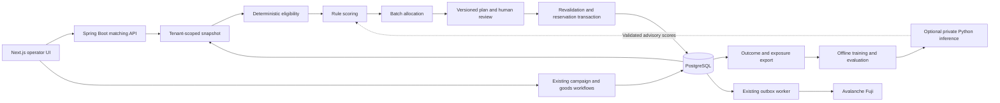

# Thiết kế AI Aid Matching cho AidBridge

Ngày 08/11/2026 · Trạng thái **PROPOSED**, bản thiết kế để review.

## 1. Executive Summary

Aid Matching đáng làm nếu điều phối viên thường xuyên phải chia cùng một lượng hàng, năng lực vận chuyển hoặc khung giờ giao cho nhiều hồ sơ đã xác minh. Khi đó, một kế hoạch chung có thể giữ lại chuyến duy nhất cho hồ sơ chỉ có một tuyến khả thi, đồng thời chỉ rõ phần nhu cầu còn thiếu. Nếu tổ chức xử lý ít hồ sơ cùng lúc hoặc tồn kho cập nhật chậm, danh sách nhu cầu và thao tác điều phối thủ công có thể mang lại phần lớn giá trị với ít chi phí hơn. Chưa có dữ liệu vận hành để xác định tình huống nào phổ biến ở AidBridge.

Đề xuất **rules trước, phân bổ theo lô, người có thẩm quyền duyệt, đo kết quả thực tế**. Java và PostgreSQL đủ cho pilot một tổ chức. Thử Logistic Regression ở chế độ shadow khi có nhãn đủ tin cậy. Chỉ đưa solver vào khi replay cho thấy heuristic bỏ lỡ các phương án có giá trị, và chỉ dùng Learning-to-Rank khi cải thiện kết quả so với rules dưới cùng bộ ràng buộc. Tối ưu phân bổ và học xếp hạng có thể được đánh giá độc lập.

| Nhãn | Căn cứ |
|---|---|
| SOURCE | Product Blueprint v1.1, tr. 3, 16–17, 19, 21 đặt AI Matching và multi-organization trust sau hackathon. MVP dùng nhu yếu phẩm, xác minh độc lập và dấu vết kiểm toán Fuji. [Product Blueprint](../source/AidBridge_Product_Blueprint_v1.1_Complete.pdf) |
| USER_CONFIRMED | D26/D27 quy định 18/11 tích hợp đủ P0, 20/11 demo ổn định, 22/11 sẵn sàng hồ sơ, 25/11/2026 là hạn nộp ngoài cùng. 56 giờ task + 8 giờ reserve mỗi người dành cho kế hoạch hiện hành. D39/D45 chọn session cookie và JPA. [MVP Scope](../planning/MVP_SCOPE.md) · [Decision Log](../planning/DECISION_LOG.md) · [Master Plan](../planning/MASTER_PLAN.md) |
| PROPOSED | Schema, API, điểm số, chính sách phân bổ, phase gates và ước lượng bên dưới là thiết kế cho pilot được duyệt riêng. |
| ASSUMPTION | Pilot đầu có một tổ chức, hàng vật lý theo item và unit cố định, dữ liệu mô phỏng, tồn khả dụng và route windows có thể đối soát. Kịch bản A/B/C dùng dữ liệu giả định. |
| OPEN | Giá trị với NGO, chất lượng tồn kho, chính sách fairness, quyền chia sẻ liên tổ chức, cơ chế chuyển hàng vào workflow campaign và quyền sử dụng dữ liệu học. |

## 2. Problem Definition

Đầu vào là tập nhu cầu đã xác minh, lượng còn cần cho từng item, tồn vật lý khả dụng, lịch giao, tuyến và năng lực còn trống tại snapshot. Đầu ra là một plan theo nguồn hàng, hồ sơ, item, quantity và delivery slot, kèm thứ tự ứng viên, lý do và unmet quantities. Ví dụ, nguồn đứng đầu của hai hồ sơ có thể chỉ còn một slot. Điểm tốt cho từng cặp vẫn cần qua bài toán phân bổ chung.

Đây là bài toán hybrid gồm eligibility có tính deterministic, ranking các phương án đã đủ điều kiện và allocation có ràng buộc. ML có thể ước lượng khả năng chấp nhận hoặc giao đúng hạn. Backend quyết định quyền, tính hợp lệ của case, item, tồn kho, hạn giao và các bước chuyển trạng thái. Phân bổ thiếu dữ liệu lịch sử vẫn hoạt động bằng rules. Nhãn giả lập chỉ kiểm tra pipeline và tính đúng của thuật toán.

## 3. Product Requirements

| Yêu cầu | Hành vi đề xuất |
|---|---|
| Verified needs | Case thuộc org đang hoạt động, đã qua independent approval, trạng thái `VERIFIED` hoặc `IN_PROGRESS`, revision đúng và đủ điều kiện nghiệp vụ, chưa có dispute chặn. |
| Supply | Ghép theo mã item và fixed unit. Hàng vật lý rảnh được phép reserve. Cam kết chưa nhận hiển thị riêng dưới dạng dự kiến, có thể phục vụ lập lịch thủ công. |
| Feasibility | Lọc vùng phục vụ, route, slot, thời gian đến, đặc tính hàng và năng lực xử lý. Lý do thiếu dữ liệu được đưa về hàng đợi điều phối. |
| Scarcity và fairness | Xem toàn bộ tập case trong batch, ưu tiên mức hỗ trợ tối thiểu theo policy, theo dõi chờ đợi, cho phép chia theo đơn vị nguyên và xuất phần thiếu. |
| Human decision | `ORG_ADMIN` được ủy quyền duyệt, sửa hoặc bỏ plan bằng reason code. Điều phối thủ công đi qua cùng guards. Case creator và delivery recorder vẫn chịu các quy tắc độc lập hiện hành. |
| Tenancy | Phase 1–2 dùng nhiều pool nội bộ nếu cần. Nhiều organization thật là Phase 3, cần quyết định riêng về grant, consent và accountability. Beneficiary tiếp tục được đại diện qua tổ chức. |
| Traceability | Lưu snapshot/version, rule/model/policy version, lý do lọc và xếp hạng, plan revisions, approvals, holds, outcomes và unmet quantities. |

Nhu cầu phải được đối chiếu với [Business Workflows](BUSINESS_WORKFLOWS.md), [API Specification](API_SPECIFICATION.md) và [Test Strategy](../quality/TEST_STRATEGY.md). Pilot dùng catalog fixture tối thiểu và quy cách hàng đã được duyệt. Mở warehouse tổng quát, đổi đơn vị và provenance tới từng hộ là các quyết định scope riêng.

## 4. System Architecture Diagram



`com.aidbridge.matching` đề xuất chứa retrieval, scoring, planner, plan controller/service và feature DTOs. `inventory` giữ stock, capacity và reservation invariants. `casefile`, `campaign`, `contribution` và `delivery` giữ quyền ghi dữ liệu nghiệp vụ của mình. Dùng Spring Data JPA và forward Flyway migration nếu được duyệt. PostgreSQL lưu cả snapshot lẫn state hiện hành. Pilot chạy trong modular monolith, với hạ tầng container theo kế hoạch đã được duyệt cho môi trường tương ứng.

Prompt giả định Java 26. [Backend POM](../../backend/aidbridge-backend/pom.xml) cấu hình Java 21. Thiết kế chọn Java 21 để bám workspace. Nếu Java 26 trở thành yêu cầu triển khai, cần quyết định riêng và kiểm tra Maven Wrapper, Spring, Web3j, runtime deployment và regression trước khi nâng.

## 5. Matching Algorithm Design

**Snapshot.** Lấy một bản đọc nhất quán bằng transaction read-only ngắn ở `REPEATABLE READ`. Ghi `asOf`, case/campaign item versions, stock/capacity versions, policy version và input digest. Đóng transaction trước khi tính score, gọi model hoặc chạy solver. Giới hạn batch, edges và thời gian bằng cấu hình. Nếu phải chia batch, công khai phạm vi cạnh tranh và phần chưa xét. [PostgreSQL transaction isolation](https://www.postgresql.org/docs/current/transaction-iso.html)

**Candidate retrieval.** Xác định từng cạnh `(source, case, item, slot)`. Chỉ giữ case đã xác minh, cùng scope được phép, có nhu cầu còn mở, hàng tương thích unit/spec, lượng vật lý rảnh dương và một slot có tuyến khả thi trước deadline. Hàng yêu cầu xử lý đặc biệt cần kiểm tra năng lực và chính sách tương ứng. Truy vấn theo org, item và vùng. Trả `NO_AVAILABLE_STOCK`, `NO_FEASIBLE_ROUTE`, `MISSING_ROUTE_DATA` hoặc `NO_AVAILABLE_SLOT` trong phạm vi người xem được phép biết. Candidate vẫn có thể hợp lệ cho một phần basket.

**Residual demand.** Mỗi item có `residual = target - activePledged - unmatchedClaimQty`. Khi chưa có campaign, dùng target của revision đã duyệt và `activePledged = 0`. `unmatchedClaimQty` là các matching claims còn hiệu lực chưa chuyển sang native commitment. Một quantity đã nằm trong `activePledged` được tính đúng một lần, dù sau đó đã received, delivered hay confirmed. Outstanding pledge giảm nhu cầu cần tìm nguồn nhưng hiển thị là dự kiến. Unmet fulfillment hiển thị riêng bằng `target - validConfirmed`. Negative residual là invariant violation cần đối soát.

**Ranking baseline.** Xếp nguồn cho từng case bằng `S = 50C + 25D + 15L + 10M`, tính trên candidate có slot khả thi. `C` là trung bình tỷ lệ phủ của **tất cả** need lines còn thiếu, dòng không có hàng đóng góp 0. `D = clamp(1 - roadKm/50, 0, 1)`, `L` là tỷ lệ phút xử lý còn trống trong khung, `M = clamp((deadline - earliestFeasibleArrival)/24h, 0, 1)`. Nếu chưa có deadline nghiệp vụ, dùng planning horizon được hiển thị và gắn cờ. Điểm dựa trên slot sớm nhất của nguồn cho nhóm hàng tương thích, dùng cùng quy tắc chọn slot khi replay. So theo điểm chưa làm tròn, sau đó ETA và stable source ID. UI trả từng contribution, item coverage và lý do plan có thể chọn nguồn xếp thấp hơn. Urgency và waiting time ưu tiên **giữa** case ở bước allocation. Scarcity điều khiển thứ tự chia hàng. Ba tín hiệu này không cần cộng vào ranking của các nguồn cho cùng một case.

**Batch heuristic.**

1. Dùng một bộ đếm tạm cho stock, need và logistics của cả batch. Cấp trước cho các dòng chỉ có một nguồn-slot khả thi và item khan hiếm, ưu tiên tier, deadline, waiting time rồi stable ID trong cùng lượt. Cấp tới policy floor ở bước này. Với fixture, các item chỉ có một nguồn phục vụ đạt floor 100% nếu khả thi, rice có floor 50%. Floor là mục tiêu với shortfall được báo cáo.
2. Duyệt các dòng chưa đạt floor, ưu tiên số lựa chọn còn lại ít, sau đó tier/deadline/waiting. Chọn cạnh còn feasible theo score và ETA. Gộp nhiều item cùng source, case và slot thành một stop. Cập nhật bộ đếm sau mỗi cấp phát, có thể đi tiếp sang nguồn khác nếu policy cho phép.
3. Dùng phần dư để tăng coverage theo urgency, deadline và waiting time, ưu tiên nguồn đã có stop khi các lựa chọn tương đương. Báo phần thiếu theo item, lý do và floor shortfall. Kế hoạch khả thi được kiểm tra lại độc lập trước khi hiện cho reviewer.

Thứ tự greedy có thể tạo ra kết quả dưới tối ưu. Dùng replay để xác định khi nào cần solver. Các lớp filter/validator dùng chung cho rule, model, solver và manual edits.

## 6. Machine Learning Architecture

| Lựa chọn | Phù hợp | Chi phí và giới hạn |
|---|---|---|
| Rule-based | Phase 1, cold start, fallback mọi phase | Dễ giải thích và replay. Weights cần đối chiếu với thực tế. |
| Logistic Regression | Phase 2, baseline phân loại pointwise cho xác suất được chấp nhận hoặc giao đúng hạn theo từng tập at-risk | Chuẩn hóa và regularize, kiểm tra calibration trên holdout. Ít nắm tương tác phi tuyến. Có thể train scikit-learn và phục vụ bằng hệ số đã version trong Java nếu parity đạt. [scikit-learn](https://scikit-learn.org/stable/modules/generated/sklearn.linear_model.LogisticRegression.html) |
| XGBoost / LightGBM classifier | Challenger Phase 2 khi dữ liệu đủ cho tương tác giữa tải, tuyến, loại hàng và giờ | Dùng một thư viện cho thử nghiệm đầu. Cần kiểm tra drift, calibration và khả năng giải thích. Điểm xác suất vẫn phụ thuộc tập được quan sát. [XGBoost objectives](https://xgboost.readthedocs.io/en/stable/parameter.html#learning-task-parameters) · [LightGBM objectives](https://lightgbm.readthedocs.io/en/stable/Parameters.html#objective) |
| LightGBM LambdaMART | Phase 3, query group `runId + caseId` có nhiều candidates được chấm và graded relevance | `LGBMRanker` với `lambdarank`, so sánh NDCG@K với rule và classifier. Phải có nhóm ứng viên và nhãn tương đối hữu ích. [LightGBM ranker](https://lightgbm.readthedocs.io/en/stable/pythonapi/lightgbm.LGBMRanker.html) |
| Learning-to-Rank | Pointwise là bước chuyển đơn giản. Pairwise học preference trong group, listwise hoặc objective hướng NDCG dùng tín hiệu cả danh sách. | So cùng candidate set, split và eligibility policy. Điểm ranking dùng để sắp thứ tự hoặc làm mục tiêu phụ của optimizer, không diễn giải thành xác suất. [XGBoost Learning to Rank](https://xgboost.readthedocs.io/en/stable/tutorials/learning_to_rank.html) |

Offline job Python lấy export đã lọc, build point-in-time features, train và lưu artifacts có checksum, feature schema, train window, threshold/guardrail và report. Rollout qua shadow, review, opt-in canary, rollback theo artifact. Phase 2 ưu tiên Java inference với Logistic Regression. FastAPI nội bộ chỉ đáng thêm khi cần phục vụ tree/ranker artifact và Java parity hoặc release cadence trở thành trở ngại có đo lường.

Khi dùng FastAPI, Spring gửi batch feature vectors và opaque candidate IDs qua private network với service authentication và transport bảo mật. Endpoint nội bộ `POST /internal/v1/score` nhận `featureSchemaVersion`, `modelVersion`, `runId`, `candidates[{candidateId,features}]), trả `modelVersion` và score theo candidate ID. Không có DB write, evidence, case identity hay public endpoint. Spring kiểm tra schema, version, đủ ID, giá trị finite và phạm vi score phù hợp, đặt timeout/batch limit và dùng rules cho cả run khi response lỗi. Reason codes dựa trên dữ liệu vận hành và policy, có thêm model contribution nếu diễn giải được. So parity Java/Python bằng fixture và version bộ preprocessing cùng model.

## 7. Feature Engineering

Mọi feature dùng dữ liệu biết được tại `asOf`. Dữ liệu thiếu giữ cờ riêng và quan sát theo vùng. Imputer/scaler của model fit trên training window.

| Feature | Định nghĩa và chuẩn hóa | Missing và leakage |
|---|---|---|
| Coverage ratio | Mỗi line `min(freeQty,residual)/residual`, lấy mean trên line còn thiếu. Cùng item/unit mới cộng. | Tồn chưa biết hoặc quá hạn kiểm tra chuyển sang manual. Không dùng receipt sau snapshot. |
| Available quantity | Integer per item/pool. ML có thể dùng ratio hoặc log1p trong cùng item/unit, giữ mask. | Tách chưa báo tồn khỏi đã hết. Không đọc inventory hiện tại để tái tạo run cũ. |
| Road distance và ETA | Distance theo route, điểm rule `D`. ETA tính cả ready time, slot, travel và handling. Margin `M` trên deadline/horizon. | Thiếu route hoặc ETA tin cậy thì manual review. Giữ estimator version, không dùng actual delivery time làm feature. |
| Organization workload | `free handling minutes / scheduled minutes` trong horizon. Free stops và capacity theo loại phương tiện là hard bounds. | Thiếu lịch hoặc mẫu số 0 thì không tự hứa slot. Không dùng load sau khi plan được duyệt. |
| Urgency, waiting time | `URGENT/NORMAL` theo approved revision, waiting từ lần verified đủ điều kiện đến snapshot, cap cho model theo policy. | Unknown tier cần đối soát. Không dùng label nhập sau outcome, kiểm tra re-verification để tránh reset chờ tùy ý. |
| Historical acceptance | `(accepted + α)/(reviewed + α + β)` trong window đã chín, kèm count. | Cold start dùng prior chung và missing flag. Chỉ quyết định đã quan sát trước snapshot, không gán negative cho hidden candidates. |
| Historical delivery success | Tỷ lệ independently confirmed trong horizon trên approved dispatch đã đủ thời gian quan sát, smoothing tương tự. | Pending/censored tách riêng. Theo dõi sample size và vùng, tránh để lịch sử ít chuyến làm nguồn nhỏ mất cơ hội. |
| Feasibility | Flags cho item compatibility, zone, deadline, handling và slot. Những flag bắt buộc được xử lý ở filter. | Unknown bắt buộc đưa về review. Không dùng label thực hiện thành công thay cho feasibility tại lúc lập plan. |
| Item scarcity | `max(0, 1 - eligibleFreeSupply/eligibleResidualDemand)` theo item, unit và planning pool, đếm mỗi stock bucket một lần. Kèm số nguồn-slot từng line. | Ratio là dấu hiệu ưu tiên, solver vẫn xét bottleneck logistics. Không cộng nguồn ở ngoài scope hoặc dựa vào cam kết chưa nhận. |

## 8. Training Data Strategy

- **Candidate snapshot** có opaque case/candidate/org refs trong tập nội bộ, `runId`, `asOf`, item/unit, need, free quantity, route/slot, feature vector, filter outcome, score/rank và versions. Log eligible set đã xét trong batch và rejection reason ở mức cần thiết. Giữ một bản input đóng băng đủ để replay.
- **Exposure và decision** lưu ứng viên nào thực sự được xem, display position, thời điểm, policy, `ACCEPTED`, `REJECTED`, `OVERRIDDEN` hoặc `NO_DECISION`, reason code và references tới accepted quantities. Giữ amendment qua append-only events. Hạn chế free text.
- **Outcome** nối theo allocation line với held, released, dispatched, native pledge/receipt, delivery, independent confirmation hoặc dispute/void, có event time, observed time và quantities. Mỗi mục tiêu có label horizon định trước. Acceptance chỉ gán trên candidate đã được reviewer quyết định. Delivery success chỉ trên nhóm được duyệt và đã đủ follow-up, với missing, pending và void được xử lý theo metric contract. Tách thời điểm nhận nhãn khỏi thời điểm feature. Override vì stock stale có nghĩa khác với bất khả thi đã biết tại snapshot.
- **Selection bias** xuất hiện vì chỉ candidate ở vị trí cao được xem và chỉ phương án được chọn mới có delivery outcome. Báo coverage theo exposure, review và dispatch. Thu thập đánh giá độc lập trên mẫu feasible candidates, kể cả những lựa chọn chưa hiển thị. Nếu có phê duyệt nghiên cứu, randomize thứ tự giữa các lựa chọn tương đương, ghi propensity và kiểm tra overlap trước khi dùng weighting. Delivery của lựa chọn chưa từng được thực hiện vẫn là counterfactual chưa quan sát. [Joachims và cộng sự, Unbiased Learning-to-Rank](https://www.cs.cornell.edu/people/tj/publications/joachims_etal_17a.pdf)
- **Splits** theo thời gian train → validation → holdout, có khoảng cách đủ cho label maturity. Gom cùng case/household proxy và revisions vào một partition, giữ nguyên query group, thử thêm holdout theo org/zone. Graded label cho ranker dựa trên đánh giá khả thi có rubric, hoặc outcome đã đủ quan sát với coverage được công bố. So NDCG trên judged sets với cùng giao thức sampling. Fixture phục vụ replay và tests. Chưa có dataset thật, sample-size estimate đã xác nhận hay model performance.

## 9. Database Schema

Đây là schema logic bổ sung. UUID, UTC timestamps, integer quantities, version counters và composite FK theo tenant. Các bảng nền `aid_cases`, `case_need_items`, `campaign_items`, `audit_events` và `blockchain_jobs` giữ ý nghĩa hiện hành. [Database Design](DATABASE_DESIGN.md)

| Quan hệ | Fields và invariant chính |
|---|---|
| `supply_pools`, `inventory_balances` | Pool có `organization_id`, service zone và status. Balance có `pool_id,item_code,unit,on_hand_qty,reserved_qty,version,observed_at`, unique theo pool/item/unit, `0 <= reserved_qty <= on_hand_qty`. `freeQty = onHandQty - reservedQty`. Incoming commitments lấy từ nguồn riêng, nằm ngoài on-hand. |
| `inventory_movements` | Append-only với tenant, balance, reservation, quantity, movement type, actor, event time và operation ID unique. Điều chỉnh hoặc return ghi movement mới, balance update cùng transaction. |
| `delivery_slots` | Owner/pool, window, zone, `max_stops`, capacity minutes và loại tải áp dụng, reserved counters và version. Giữ capacity theo các dimension có đơn vị nhất quán. |
| `matching_runs`, `matching_candidates`, `matching_exposures` | Run có owner org, as-of, policy/model version, snapshot/digest và solver status. Candidates giữ immutable feature/score và scoped refs. Exposures lưu lần hiển thị thực sự. Index theo owner và thời gian. |
| `allocation_plans`, `allocation_lines`, `allocation_decisions` | Run → plan → revisions và lines. Line ghi case need/revision, source balance, slot, item/unit và proposed quantity. Quyết định append-only, gắn plan revision, actor, reason, timestamp. Duy nhất một lần thực thi mỗi approved revision. |
| `inventory_reservations`, `matching_demand_claims` | Line → reservation/claim, unique theo line đã finalize. Reservation giữ remaining quantity, expiresAt và lifecycle. Claim giữ demand identity và quantity chưa chuyển, có FK/unique mapping theo lượng được chuyển vào native commitment line. Giữ slot reservation riêng theo `(plan revision, source, case, slot)` để nhiều goods lines dùng cùng stop. |
| `matching_outcomes` | Append-only, unique theo source event và allocation line, lưu time, type, quantity, projected business refs. Outcome dùng cho feedback, đọc được theo scope. |
| Phase 3 · `supply_offers`, `sharing_grants` | Supplier publish quantity cap, item, zone và validity window. Grant định nghĩa organization pair, purpose, fields, expiry/revoke và policy version. Case org và supply org được lưu riêng và kiểm tra trên mọi association. |

Index lookup theo `(organization_id,item_code,unit,pool_id)`, slot theo owner/window/zone và partial index cho reservation còn active theo expiry. Dùng CHECK cho lượng dương và balance bounds, foreign keys cho cross-reference, transaction guards cho tổng liên bảng. Schema pilot đi qua clean/upgrade migration, tenant isolation, concurrency và reconciliation tests trước rollout.

## 10. API Design

Prefix đề xuất `/api/organizations/{organizationId}/matching`. Dùng session cookie và CSRF, active membership với `ORG_ADMIN` trong org `APPROVED` cho các thao tác pilot, `Cache-Control: no-store`, ProblemDetail và `Idempotency-Key` cho mutations. Quyền đọc và ghi được kiểm tra cả khi replay. Authorization lấy từ session, resource và quan hệ trong DB. Mọi time dùng UTC ISO-8601.

| Endpoint | Request → Response |
|---|---|
| `POST /runs` | `MatchingRequest` → `MatchingRunResponse`, 201 với Location. Batch giới hạn cho Phase 1, chạy xong trong request. Async 202 và DB-backed job là lựa chọn sau khi đo. |
| `GET /runs/{runId}` | Run status, snapshot time, candidate pages, unmet reasons và references tới plan. |
| `GET /plans/{planId}` | Plan revision, proposals, snapshot versions, approvals và reservation status. |
| `POST /plans/{planId}/revisions` | `expectedVersion,lines[],reasonCode` → revision mới. Server xác nhận line và revalidate toàn batch, revision cũ superseded. |
| `POST /plans/{planId}/decisions` | `expectedVersion,decision,reasonCode`, với `APPROVE` hoặc `DECLINE` → `PlanDecisionResponse`. Approve single-org finalize cả revision và reserve atomic. |
| `POST /reservations/{reservationId}/releases` | `expectedVersion,reasonCode` → trạng thái release, chỉ quantity còn giữ. Slot được giải phóng khi toàn bộ công việc tương ứng bị hủy trước handoff và còn trong thời gian có thể tái sử dụng. |

Ví dụ DTO rút gọn, ký hiệu ID trong ví dụ đại diện UUID.

```text
MatchingRequest {
  caseIds?: UUID[], planningWindowEnd: Instant
}
MatchingRunResponse {
  runId: UUID, asOf: Instant, policyVersion: string, mode: RULES | MODEL,
  planId: UUID, planVersion: integer,
  candidates: [{candidateId, caseId, sourceId, score,
                contributions: [{feature, normalizedValue, points}], reasonCodes: string[]}],
  lines: [{lineId, caseNeedItemId, sourceId, slotId, itemCode, unit, quantity: integer}],
  unmet: [{caseNeedItemId, itemCode, unit, quantity: integer, reasonCodes: string[]}]
}
PlanDecisionResponse {
  planId: UUID, planVersion: integer, decisionId: UUID,
  status: RESERVED | DECLINED, reservationIds: UUID[], expiresAt?: Instant
}
```

Nếu có `caseIds`, UI hiển thị phạm vi batch đã chọn và tác động đến coverage. Policy, snapshot time và stock được server xác định. Phase 3 thêm quyết định của từng participating org và trạng thái `AWAITING_APPROVALS`; supplier nhận projection tối thiểu của offer được chọn và delivery window đã được chia sẻ. Duyệt lại khi sửa quantity, line, route hoặc slot. Supplier approval không cấp quyền đọc hồ sơ.

**Workflow và transaction boundaries**

1. **Prepare.** Authorize, đọc snapshot và tính plan ngoài write transaction. Lưu run/plan immutable, idempotency response và audit trong transaction ngắn. Preview chỉ mô tả phương án, chưa giữ hàng. Hai request có cùng key có thể tính preview trùng nhưng chỉ một kết quả được ghi. Trước khi duyệt, UI hiển thị quantity, floor shortfall, tác động của override và thời điểm snapshot.
2. **Approve.** Transaction claim idempotency key, khóa auth/grant state cần cho quyết định, rồi theo thứ tự thống nhất `case → campaign → campaign item / need row → plan → balance → slot → reservation`, khóa theo UUID trong mỗi nhóm. Dùng lock cho case root cả khi campaign chưa tồn tại. Recheck membership, grants, review/version, dispute, expiry, item and unit, deadlines, current pledge/claim, stock và slot capacity. Có constraint riêng chống double-finalize với key khác. Ghi approval, holds, claims, slot, audit và idempotency result trong cùng commit. Quantity thiếu ở bất kỳ line nào rollback cả revision. Hold hết hạn theo mốc sớm hơn giữa TTL của policy và thời điểm chốt xuất hàng của slot. Phase 3 mỗi org có decision append-only, finalize chỉ khi tất cả approvals cùng revision còn hiệu lực và tất cả scope/quantity được revalidate trong cùng DB. Thiếu một approval thì giữ plan pending, có thể tạo revision nhỏ hơn và xin duyệt lại. Không giữ SQL lock trong lúc chờ người duyệt.
3. **Protect capacity.** Mọi đường ghi cạnh tranh lấy cùng lock order. Native pledge và chuyển đổi claim cùng khóa demand anchor và kiểm tra `activePledged + outstandingClaims <= target`; khi chuyển, lượng claim giảm đúng bằng lượng native pledge tăng trong cùng transaction. Campaign publish/create dùng cùng case lock và ánh xạ approved need identity. Các đường cancel, dispute, stock adjustment và slot update phải serialize với writer liên quan. Trước khi sửa workflow P0 để dùng shared demand guard, chỉ chạy pilot với fixture data cô lập. Kiểm thử PostgreSQL thật với hai session, cả rollback và competing native pledge. [PostgreSQL row locking và deadlocks](https://www.postgresql.org/docs/current/explicit-locking.html)
4. **Consume hoặc release.** Khi nguồn xuất hàng thực tế, giảm `on_hand_qty` và `reserved_qty` đúng quantity đã dispatch, ghi movement và chuyển demand claim theo bước tích hợp đã duyệt. Một claim còn in transit vẫn chặn cấp phát trùng nếu native pledge chưa ghi. Hold hết hạn hoặc bị hủy chỉ release phần chưa xuất và quantity claim tương ứng chưa chuyển. Phần đã dispatch giữ đến khi được mapping hoặc đối soát bằng return/loss/correction được duyệt. Expiry worker dùng DB, có batch limit và recheck sau khi khóa. Cùng các khóa và unique operation IDs giúp dispatch, release và expiry tranh chấp an toàn, có thể retry. Quy tắc áp dụng cả khi source hoặc org bị đình chỉ. Luồng vận hành mới dừng, còn reconciliation do actor có quyền thực hiện.
5. **Handoff và feedback.** Native commitment chỉ xuất hiện khi có tác nhân và nghiệp vụ hợp lệ. Route xuất hàng, receipt và independent confirmation cung cấp outcome events. Chuyển từ nguồn sang campaign phải có mapping rõ để stock ở nơi gửi và receipt ở nơi nhận là hai sổ riêng. Hàng trong cùng tổ chức cần xác định rõ custody boundary hoặc cơ chế điều chuyển nội bộ trước tích hợp. Phase 1 có thể chạy fixture reservation và thực hành lifecycle bằng native records hợp lệ trong môi trường cô lập. Cơ chế cấp phát ghi đồng thời vào workflow campaign thật là gate riêng.

**Errors.** 400 cho payload invalid, 401 khi mất session, 403 khi thiếu role trên resource được phép biết hoặc thiếu CSRF, 404 ngoài scope, 409 `VERSION_CONFLICT`, `INSUFFICIENT_STOCK`, `CAPACITY_CONFLICT`, `INVALID_STATE`, `IDEMPOTENCY_CONFLICT` hoặc `DISPUTE_OPEN`, 429 khi quá giới hạn và 503 khi DB unavailable. 409 trả reason code và hướng refresh plan mà không lộ stock ngoài quyền. Retry transient deadlock/serialization bằng transaction mới, giới hạn lần thử. Khi client chưa biết commit có thành công, replay cùng key. Model hoặc solver timeout dùng rules/heuristic và trả `mode` thực tế. Khi snapshot stale, manual hoặc replan vẫn phải qua live guards. [API conventions](API_SPECIFICATION.md)

## 11. Allocation Optimization

Với các cạnh hợp lệ, đặt `x[s,r,i,t]` là số nguyên không âm từ source `s` cho request `r`, item `i`, slot `t`. Đặt `y[s,r,t]` nhị phân để mở stop, `u[r,i]` là quantity chưa được phân và `f[r,i]` là floor shortfall. Trần `U[s,r,i,t]` là min của giới hạn cạnh, stock và residual demand. Chỉ tạo biến cho cạnh đã qua eligibility.

| Ràng buộc | Mô tả |
|---|---|
| Supply | `Σ(r,t) x[s,r,i,t] ≤ available[s,i]`. Supply dùng chung qua nhiều slot và case. |
| Demand | `Σ(s,t) x[s,r,i,t] + u[r,i] = residual[r,i]`. Đơn vị cố định và residual đã loại phần có nguồn. |
| Stops | `x[s,r,i,t] ≤ U[s,r,i,t] × y[s,r,t]`. Tổng `y` theo source-slot ≤ free stops. Nhiều items dùng cùng stop. |
| Shared capacity | `Σ(r,i) handling[i] × x[s,r,i,t] + Σ(r) setup[s,r,t] × y[s,r,t] ≤ freeMinutes[s,t]`. Có thể thêm trần kg/volume bằng hệ số quy đổi cho vận chuyển đã xác minh, vẫn lưu quantity theo fixed unit. |
| Policy và approvals | Cạnh phải có grant, route, deadline và compatible handling. Trần số nguồn/hộ nếu policy yêu cầu. Phase 1 chỉ dùng pool của owning org. |
| Floor | `Σ(s,t) x[s,r,i,t] + f[r,i] ≥ floor[r,i]`, `0 ≤ f ≤ floor`. Floor được làm tròn theo policy item, kèm shortfall khi không đủ hàng. |

Đề xuất objective theo thứ tự lexicographic. (1) Giảm normalized floor shortfall theo policy và urgency tier đã duyệt. (2) Giảm normalized unmet quantity, có weight urgency, deadline và aging. (3) Với mức service tương đương, giảm chi phí logistics/stops, dùng ranking score làm tie-break mềm. Chuẩn hóa mỗi line theo residual hoặc policy item weight để kg gạo và hộp nước không bị cộng như một đơn vị. Cap và scale về hệ số nguyên cho CP-SAT, kiểm tra bounds và sai số làm tròn. Chạy từng cấp objective với budget, giữ mức đã đạt ở cấp trước khi tối ưu cấp sau. Giải thích `SUPPLY_SCARCE`, `RESERVED_FOR_ONLY_FEASIBLE_ROUTE`, `FAIRNESS_FLOOR` hoặc `DEADLINE` theo các số lượng và constraints quan sát được.

| Phương án | Điều kiện chọn |
|---|---|
| Greedy theo batch | Phase 1. Đơn giản, dễ replay, cần fixture cho slot contention, scarcity và starvation. |
| LP | Dùng làm bound hoặc replay baseline. LP tổng quát có thể trả số lẻ. Với mô hình mỗi item là mạng flow thuần, capacities và demands nguyên, dùng min-cost flow để giữ đơn vị nguyên. Shared stops/capacity giữa items có thể phá cấu trúc này. [OR-Tools min-cost flow](https://developers.google.com/optimization/flow/mincostflow) |
| MIP | Dùng integer quantity và binary stop, hỗ trợ linear shared constraints và có thể đo gap nếu backend solver báo bound. So với greedy trên cùng dữ liệu và runtime budget. [OR-Tools MPSolver](https://developers.google.com/optimization/lp/mpsolver) |
| OR-Tools CP-SAT | Ưu tiên benchmark khi có nhiều ràng buộc integer, điều kiện và slot activation. OR-Tools là toolkit, có cả CP-SAT và MIP/LP interfaces. Chỉ tích hợp runtime sau khi đo chất lượng và độ ổn định. [OR-Tools CP-SAT](https://developers.google.com/optimization/cp/cp_solver) |

Đặt time limit và lưu solver version, seed/config, status, objective/bound nếu có. `FEASIBLE` chỉ mô tả một nghiệm hợp lệ và có thể dùng nếu validator độc lập đạt và objective đạt ngưỡng chính sách. `OPTIMAL` áp dụng cho snapshot và model đã giải. `UNKNOWN` hoặc model invalid dùng heuristic đã validate. Với `u` và `f` cho phép phần thiếu, nghiệm cấp 0 phải khả thi dưới hard bounds hợp lệ. `INFEASIBLE` là tín hiệu kiểm tra input/model trước khi phục vụ plan fallback.

## 12. Blockchain Integration

| Record | Nơi ghi và ý nghĩa |
|---|---|
| Candidate, scores, inventory snapshots, private beneficiary info | Off-chain. Minimized model features lưu trong hệ thống có tenant authorization. Hồ sơ và evidence đi qua private endpoints của org. |
| Human approval, override, hold/release | Append-only local audit, gắn actor, revision, quantities và reason codes. Không có registry event mới cho đề xuất matching. |
| Inventory commitment | Hold là claim nội bộ. Native donor pledge thực tế có thể phát `AID_PLEDGED` theo G01 khi đủ điều kiện. Stock và slot không nằm trên Fuji. |
| Receipt, delivery, independent confirmation | Reuse các mốc nghiệp vụ hiện có khi điều kiện tương ứng được thực thi. Evidence gốc được quản lý theo version off-chain. |
| Hash/verification reference | Existing registry commitment theo canonical manifest và opaque random refs. Public view chỉ dùng projection đã sanitize và chain context xác minh được. |

Native business write, audit và outbox commit cùng nhau. Worker giữ logical event ID khi retry, lưu signed bytes và tx hash trước broadcast, xử lý RPC ngoài transaction nghiệp vụ. Chỉ ghi confirmed on-chain sau khi verify receipt thành công và expected log đúng deployment context, event ID và commitment. Pending chain là trục riêng với business status và evidence review. Calldata/events/logs/public DTO không chứa PII, evidence gốc, private URL, credentials, salt hoặc model vector. Hash evidence và relayer authorization cho phép đối chiếu record đã được ghi. Bàn giao vật lý dựa trên quy trình con người, bằng chứng và xác nhận độc lập, kể cả khi các actor có thể thông đồng. [Blockchain Architecture](BLOCKCHAIN_ARCHITECTURE.md) · [B01 event mapping](B01_BASELINE.md#4-initial-audit--contract-event-mapping)

## 13. Security and Responsible AI

- Backend enforce tenant, membership, role, scope, CSRF, current business state và identity. Platform role không tự cấp quyền đọc PII/evidence. Override cần reason code và revalidation. Eligibility rejection và mọi quyết định ảnh hưởng người nhận được xử lý bởi người có thẩm quyền. Không có beneficiary auto-reject.
- Lưu district/zone coarse và ETA cho matching. Exact address, evidence và contact chỉ đi qua luồng nghiệp vụ hạn chế. Export có opaque refs, phân quyền riêng, retention đã phê duyệt, access audit, encryption và kiểm thử PII leakage. Tránh lưu free text vào model dataset. Dữ liệu thật cần quyết định riêng về consent, mục đích, retention và quyền sử dụng.
- Báo coverage, waiting time và no-feasible-route rate theo urgency và zone. So nhóm tương đồng về mức cần hỗ trợ và xem cả vùng thiếu route data. Tổng hợp theo cohort và ẩn nhóm nhỏ để hạn chế nhận diện lại. Không dùng protected attributes trong scoring baseline. Thuộc tính phục vụ fairness audit chỉ thu thập nếu có mục đích, quyền và kiểm soát phù hợp.
- Review trọng số, floor, tuổi chờ và tác động của model trước canary. Tách `REJECTED` bởi reviewer khỏi `NO_CANDIDATE` và `NO_DECISION`. Tổ chức có kênh giải thích, rà soát và sửa ưu tiên qua quy trình hồ sơ.
- Theo dõi missingness, coverage, calibration, drift, approval/override, gap theo vùng, solver status và stale conflicts. Nếu vi phạm constraint hoặc scope, tắt proposal generation và điều tra. Khi model gặp lỗi, dùng rules. Khi stock/route thiếu hoặc rule service không khả dụng, tiếp tục điều phối thủ công với cùng kiểm soát nghiệp vụ. [Security & Privacy](../quality/SECURITY_PRIVACY.md)

## 14. Evaluation Strategy

So với manual planning, rules hoặc heuristic trên cùng tập case, stock, slot và timestamp. Đo rule versus model trên cùng eligible candidate set. Đo solver versus heuristic với cùng candidate scores và business constraints. Replay dùng fixture và snapshot lịch sử khi có quyền. Online pilot dùng shadow trước, sau đó review có kiểm soát. Báo confidence intervals, cỡ mẫu, censoring và coverage theo cohort. Các ngưỡng dưới đây là gates đề xuất.

| Lớp đánh giá | Metrics và cách đọc |
|---|---|
| Ranking | Precision@K = judged relevant trong top K / số phần tử top K trên judged set. NDCG@K dùng graded relevance và ideal order cùng query. Report K, judged coverage và query không có relevant item riêng. Thay đổi top-K chỉ hữu ích nếu không làm xấu allocation outcomes. |
| Classification | PR-AUC cho label hiếm, precision/recall ở threshold nếu có, Brier score và calibration plot. Acceptance và on-time confirmation có label populations khác nhau. Đánh giá riêng, báo tỷ lệ các candidates không quan sát được. |
| Adoption | `accepted / reviewed` trên eligible recommendations đã được reviewer quyết định. Report exposure → review conversion, override rate/reason và thời gian từ snapshot đến plan usable. |
| Allocation quality | Per-item fulfillment = independently confirmed / approved target theo cohort và horizon, report cả macro case coverage và unmet. Time to fulfillment tính từ verified đến full independent confirmation, báo median/P90 cùng tỷ lệ chưa hoàn thành hoặc survival estimate. Utilization tính per item/slot với numerator, denominator và horizon cùng đơn vị. Báo cả utilized stock và used stops so với available. |
| Fairness | On-time confirmed coverage gap và waiting-time gap theo zone trong cùng urgency tier. Theo dõi floor shortfall, share nhận một phần, zero-service rate và nguyên nhân excluded. Xem phân phối và sample size trước khi diễn giải chênh lệch. |
| Safety và vận hành | Zero tenant leak, unauthorized approval, stock underflow, duplicated hold và constraint violation. Theo dõi p95 planning latency, solver timeouts, snapshot age, stale approval conflicts và reconciliation differences. Dùng DB counts và audit assertions, không lấy acceptance rate thay cho safety. |

Trước pilot, Minh và tổ chức chốt K, label windows, cohort sizes và giới hạn fairness/latency theo mức tải. Chỉ chuyển khỏi rules khi holdout và shadow/canary có cải thiện đủ tin cậy về outcome đã chọn, constraint violations bằng 0 và fairness nằm trong giới hạn đã duyệt. Nếu chưa đủ dữ liệu, tiếp tục manual/rules và thu thập thêm. Model score tăng tự thân không phải tiêu chí rollout.

## 15. Three-Phase Implementation Roadmap

| Phase | Features và engineering tasks | Dependencies và difficulty | Acceptance, risks và deliverables |
|---|---|---|---|
| **1 · Hackathon MVP — prototype matching cô lập** | Giai đoạn mang tên theo brief. Đầu ra trong hồ sơ thiết kế là kịch bản fixture và worked allocation ở §18. Pilot triển khai sau hackathon sẽ có deterministic retrieval/scoring, batch heuristic, UI duyệt, reservation/idempotency và audit nội bộ. | Cần user duyệt pilot, xác nhận policy, stock semantics, P0 release evidence và capacity mới. Mức **L**, 82 giờ-người ước lượng cho pilot fixture. | Positive/negative, concurrency, expiry và scope gates ở §19. Rủi ro lớn nhất là dữ liệu tồn kho hoặc mapping pledge sai. Deliverables sau phê duyệt gồm fixture replay, migration/API/UI pilot và test report. Tích hợp với hàng thật phụ thuộc quyết định và estimate riêng. |
| **2 · ML-Enhanced Matching** | Instrument exposure/decisions/outcomes, export có point-in-time snapshots, train Logistic Regression bằng scikit-learn, thử tree classifier khi có cơ sở, đánh giá offline, shadow inference và monitoring. | Phase 1 pilot, quyền sử dụng dữ liệu, labels đã đủ thời gian quan sát, đánh giá selection bias và điều kiện rollback. Mức **L**, 94 giờ-người, chưa gồm thời gian chờ dữ liệu chín. | Reproducible dataset/report, parity, model card, metrics theo vùng, fallback khi artifact sai. Nếu chưa đủ dữ liệu thì dừng ở rules và tiếp tục instrumentation được duyệt. Rủi ro chính là exposure bias và outcome chậm. |
| **3 · Intelligent Aid Allocation** | Benchmark LP/flow, MIP hoặc CP-SAT trên replay. Thử LambdaMART theo nhóm. Thêm fairness constraints, nhiều org cùng thực hiện một case, model monitoring/retraining và ops runbook. | Solver benchmark có thể tiến hành độc lập với LTR sau khi có snapshot. Multi-org cần trust/grants/custody, privacy review và authority cho handoff. Mức **XL**, 140 giờ-người sơ bộ. | Replay có lợi ích so với heuristic, independently validated constraints, multi-org approval/revoke test, partial approval/replan, shadow/ranker report, runbook và rollback. Rủi ro gồm coupling giữa tổ chức, runtime và fairness trade-offs. |

Mốc 18/11, 20/11, 22/11 và hạn 25/11 theo D26/D27 áp dụng cho AidBridge v1.1. Lịch ba phase matching dùng dependency gates, chưa gán ngày. Phase 1 của brief có thể đọc như thiết kế một MVP matching, còn slot hackathon dành cho workflow v1.1. Dùng manual workflow làm comparator. Sau khi user duyệt và nhóm xác nhận capacity mới, có thể thu hẹp pilot theo số pool, số case hoặc phạm vi fixture. [Decision Log](../planning/DECISION_LOG.md)

## 16. Team Task Distribution

Các ID `M` dưới đây dùng riêng cho đề xuất. Owner chịu đầu ra. Support được tính một lần trong cột giờ. Mỗi ước lượng bao gồm học, thực hiện, tests, review và docs. Giờ chờ đối tác, dữ liệu và review bên ngoài cần forecast riêng.

| Task | Primary và giờ | Support đã tính | Dependency và đầu ra |
|---|---|---|---|
| M11 · Pilot workflow và policy fixtures | Minh 10h | Dũng 2h, feasibility và demand semantics | Scope approval → policy, baseline manual và fixtures |
| M12 · Snapshot, planner, schema và reservation API | Dũng 30h | Khoa 6h, fixtures cạnh tranh và replay validator | M11 → end-to-end DB path với guards |
| M13 · UI review và E2E | Minh 16h | Dũng 4h, DTO/handoff | M12 contract → preview, override, stale, partial và manual |
| M14 · Reconciliation và audit regression | Khoa 10h | Dũng 2h, SQL/audit mapping. Minh 2h, E2E | M12/M13 → outbox/receipt boundary, failure fixtures, review |
| M21 · Feedback schema và export | Dũng 24h | Khoa 6h, outcome mapping | Phase 1 → point-in-time export, lineage, no-PII tests |
| M22 · Baseline model và offline evaluation | Khoa 20h | Dũng 8h, feature/Java parity | M21 + labels đủ → reproducible benchmark |
| M23 · Shadow pilot và fairness review | Minh 16h | Khoa 4h, metrics | M22 → adoption, fairness report và opt-in UX |
| M24 · Inference, versioning và fallback | Dũng 12h | Khoa 4h, artifact validation | M22 → Java shadow path và rollback evidence |
| M31 · Multi-org policy và grants UX | Minh 16h | Dũng 6h, tenant boundaries. Khoa 4h, event accountability | Quyết định trust riêng → actors, field visibility và revoke flows |
| M32 · Cross-org transaction, custody và authorization | Dũng 34h | Khoa 10h, integration và audit regression | M31 + handoff approval → scoped offers, per-org approval, all-or-nothing finalize |
| M33 · Solver replay và ranker benchmark | Khoa 30h | Dũng 8h, integration/constraint validator | Phase 1 replay cho solver, M22 + grouped labels cho ranker → benchmarks |
| M34 · Operator rollout và fairness monitoring | Minh 20h | Dũng 6h, metrics API. Khoa 6h, model/solver runbook | M32/M33 → integrated E2E, shadow/canary review, rollback |

Ước lượng theo người (Dũng / Khoa / Minh) là **38 / 16 / 28 giờ** cho Phase 1, **44 / 34 / 16 giờ** cho Phase 2 và **54 / 50 / 36 giờ** cho Phase 3. Phase 1 có thể reforecast sau M11. Dũng giữ Java nghiệp vụ, SQL, audit và REST, hỗ trợ Java integration. Khoa review ABI/event, signing/nonce/receipt/log ở ranh giới hiện có và phụ trách thử nghiệm solver/model với hỗ trợ của Dũng. Minh phụ trách product, UI và E2E. Cross-owner review cho tenancy, concurrency và event mapping là điều kiện nghiệm thu. [Team Responsibilities](../planning/TEAM_RESPONSIBILITIES.md) · [Task Backlog](../planning/TASK_BACKLOG.md)

## 17. Technical Risks and Mitigations

| Rủi ro | Tín hiệu và biện pháp |
|---|---|
| Hệ thống thiếu inventory accuracy | Nhiều approvals 409 hoặc lệch stock khi nhận hàng. Hiển thị `asOf`, kiểm kê snapshot, expiry và manual handling cho dữ liệu stale. Dũng sở hữu ledger reconciliation. |
| Hứa vượt số hàng hoặc double counting | Replay concurrent pledge, reserve, expire và dispatch. Kiểm tra cùng locks, DB constraints, transactional movement/claim mapping và rollback toàn bộ khi conflict. |
| Một case giữ mất tuyến duy nhất của case khác | Kiểm thử bottleneck trên batch, đo floor shortfall và tối ưu lexicographic. Giữ reasons để reviewer thấy tác động của override. |
| Bias với tổ chức ít lịch sử hoặc vùng xa | Cold-start prior, missing flags, tier/floor/aging, theo dõi coverage theo vùng. Minh review với tổ chức trước rollout. |
| Model drift, ít labels, hoặc đánh giá lệch | Temporal holdout, selection-bias audit, canary và rule fallback. Hoãn model rollout khi chưa đạt gate. |
| Lộ case qua multi-org plan hoặc audit | Grant field-level, opaque refs, scope test, cache/no-store và snapshot retention. Khoa và Dũng review local/public event mapping. |
| Solver vượt ngân sách thời gian | Bounded batch, time limit, independent validation, heuristic fallback và latency report. |
| Lỗi RPC trong lúc giao hàng | Dữ liệu nghiệp vụ và outbox đã commit, chain hiển thị pending hoặc failed đúng trạng thái, giữ retry/reconciliation hiện hành. |
| Scope hoặc năng lực nhóm bị kéo giãn | Giữ lịch P0 theo D26/D27. Capacity riêng và proof of value là điều kiện vào pilot. |

## 18. Example End-to-End Workflow

### Input và giả định fixture

| Household | Verified demand | Priority và hạn |
|---|---|---|
| A | 20 kg rice, 2 boxes noodles | URGENT, 48h |
| B | 10 kg rice, 1 box `INFANT_FORMULA_FIXTURE` | NORMAL, 48h |
| C | 30 kg rice, 5 boxes water | URGENT, 24h |

Prompt chưa ghi lượng/quy cách baby milk. Fixture giả định B cần **1 box** và Z có **1 box** cùng spec đã được xác nhận cho bài toán mô phỏng. Hàng thật cần chính sách phù hợp và human approval trước khi vào catalog pilot. A/B/C là case của tổ chức điều phối. X/Y/Z trong kịch bản là nguồn hàng của ba organization với sharing grants giả định theo Phase 3. Để replay Phase 1, chúng có thể là ba pool của cùng một tổ chức.

| Source | On-hand trong prompt (và giả định milk) | Free workload ratio | Route fixture |
|---|---|---|---|
| X | 100 kg rice, 10 boxes noodles | 0,80 | A 10 km, B 20 km. C quá hạn. |
| Y | 50 kg rice, 20 boxes water | 0,60 | A 15 km, B 25 km, C 20 km và ETA 12h. Chỉ còn **1 stop** trong khung. |
| Z | 30 kg rice, 1 box milk | 0,80 | A 30 km, B 10 km. C ngoài service zone. |

A/B có ETA khả thi trong 24h tại các nguồn được liệt kê, nên margin score `M = 1`. Với C–Y, `M = (24 - 12)/24 = 0,5`. X/Z có đủ hai stops nếu được dùng. Handling/vehicle capacity đáp ứng các số lượng được chọn. Giả định không có native commitments trên A/B/C. Reserve từ trước trong stress case thuộc các công việc khác.

### Filter, features và ranking

X, Y, Z đều qua filter cho A/B nhờ có rice. Chỉ X phục vụ noodles A, chỉ Z phục vụ milk B. Chỉ Y qua filter cho C và có cả rice lẫn water. X–C và Z–C bị loại trước scoring. Dùng công thức §5, các số làm tròn để hiển thị.

| Case–source | Coverage đủ hàng | Distance feature D | L | M | Điểm đủ hàng |
|---|---:|---:|---:|---:|---:|
| A–X | (1 + 1)/2 = 1 | 0,80 | 0,80 | 1 | 92,00 |
| A–Y | (1 + 0)/2 = 0,50 | 0,70 | 0,60 | 1 | 61,50 |
| A–Z | (1 + 0)/2 = 0,50 | 0,40 | 0,80 | 1 | 57,00 |
| B–X | (1 + 0)/2 = 0,50 | 0,60 | 0,80 | 1 | 62,00 |
| B–Y | (1 + 0)/2 = 0,50 | 0,50 | 0,60 | 1 | 56,50 |
| B–Z | (1 + 1)/2 = 1 | 0,80 | 0,80 | 1 | 92,00 |
| C–Y | (1 + 1)/2 = 1 | 0,60 | 0,60 | 0,50 | 79,00 |

Ví dụ A–X đạt `50×1 + 25×0,8 + 15×0,8 + 10×1 = 92`. Ranking là A `X > Y > Z`, B `Z > X > Y`, C `Y`. Rice tổng nhu cầu 60 kg. Với 180 kg free và các route trên, plan cấp X→A 20 kg + 2 boxes noodles, Z→B 10 kg + 1 box milk, Y→C 30 kg + 5 boxes water. Mỗi nguồn dùng một stop. Nhu cầu được phân đủ, với một nguồn cho mỗi hồ sơ.

### Stress test về scarcity và partial fulfillment

Thêm holds cho các công việc khác lần lượt 85 kg tại X, 25 kg tại Y và 20 kg tại Z. On-hand trong prompt giữ nguyên. Free rice là X 15, Y 25, Z 10 kg, tổng 50 kg. Scarcity ratio bằng `1 − 50/60 = 1/6`. B vẫn đủ coverage tại mọi cạnh rice và giữ ranking. A–X còn `C = (15/20 + 1)/2 = 0,875`, điểm 85,75. A–Y giữ 61,50, A–Z còn `C = (10/20 + 0)/2 = 0,25`, điểm 44,50. C–Y còn `C = (25/30 + 1)/2 = 11/12`, điểm 74,83. A–Y đứng trên A–Z. Nếu xử lý riêng A trước, có thể dùng Y để bù 5 kg, chiếm stop duy nhất của Y và khiến C mất toàn bộ tuyến.

Heuristic mở stop X–A cho noodles, Z–B cho milk và Y–C cho water vì đây là các cạnh duy nhất. Y còn 0 stop mới, nhưng có thể thêm rice cho C trong stop đã mở. Với floor 50% cho rice, cấp A 10 kg từ X, B 5 kg từ Z, C 15 kg từ Y. Còn X 5 kg, Y 10 kg, Z 5 kg. Dùng phần dư cho urgent cases, A thêm 5 kg từ X và 5 kg từ Z, C thêm 10 kg từ Y. A cần một stop nữa của Z, trong giới hạn hai stops. B giữ floor. Y vẫn chỉ giao một chuyến tới C.

| Household | Plan cuối | Rice coverage | Unmet |
|---|---|---:|---|
| A | X 15 kg rice + 2 boxes noodles. Z 5 kg rice. | 20/20 = 100% | 0 |
| B | Z 5 kg rice + 1 box milk. | 5/10 = 50% | 5 kg rice |
| C | Y 25 kg rice + 5 boxes water. | 25/30 = 83,3% | 5 kg rice |

Tổng 50/60 kg rice được phân. C chỉ tiếp cận tối đa 25 kg trong fixture. A tối đa 20 kg. Sau khi B giữ tối thiểu 5 kg, hai case urgent cùng đạt mức tối đa 45 kg khả thi. Plan sử dụng bốn stops và phân đủ các line khác. B còn thiếu vì ưu tiên urgent sau floor, C còn thiếu vì tuyến và stock. Đây là kết quả tính tay theo policy minh họa, chưa có solver benchmark.

### Approval, reservation, delivery và feedback

1. Org điều phối duyệt revision, sau đó X/Y/Z duyệt những lines và windows thuộc mình. Một thay đổi ở tuyến Z–A tạo revision mới, yêu cầu duyệt lại. Nếu stock thay đổi trong lúc chờ, finalize trả conflict và không tạo hold nào cho revision đó.
2. Khi duyệt đủ, transaction reserve X 15 kg rice và 2 boxes noodles, Y 25 kg rice và 5 boxes water, Z tổng 10 kg rice và 1 box milk. Free rice của cả ba nguồn còn 0. Free noodles còn 8 boxes, water còn 15 boxes, milk còn 0. Hold giữ hàng và slot. `on_hand_qty` chỉ giảm tại dispatch thực tế.
3. Tại handoff đã được phê duyệt, lập native pledge khi có actor hợp lệ, ghi receipt tại bên nhận thực tế, rồi volunteer ghi delivery. Reviewer khác volunteer đó kiểm tra evidence version để confirm. Chẳng hạn nếu cả hai deliveries của A được confirm đủ theo từng item và không có dispute, A có thể đạt điều kiện đóng theo workflow. B/C vẫn còn thiếu 5 kg rice dù toàn bộ plan đã giao đúng. Chain có thể còn pending khi business confirmation đã được ghi.
4. Feedback lưu run/version, exposure, quyết định, `RESERVED_FOR_ONLY_FEASIBLE_ROUTE` cho Y–C, từng lượng dispatched/received/confirmed và remaining need. Nếu Z–A thất bại, ghi failed attempt và lý do, đưa 5 kg về đối soát và điều phối theo movement/claim thực tế. Nhãn delivery chỉ kết luận sau horizon. Option A–Y chưa dùng vẫn là một counterfactual.

## 19. MVP Acceptance Criteria

Đây là checklist nghiệm thu **MVP matching** sau khi được duyệt. Kịch bản §18 cung cấp expected results để viết tests. Các kết quả dưới đây cần được đo trên implementation.

- **Eligibility và replay.** Verified cases, approved active org, integer/unit và route windows được filter. Unverified, stale, disputed, incompatible, wrong-tenant và thiếu route được chặn hoặc chuyển đúng queue. Cùng snapshot, policy và seed cho cùng deterministic output, đầy đủ reason codes.
- **Allocation.** Fixture đủ hàng và stress case khớp quantities §18. Có test thiếu hàng hoàn toàn, floor shortfall, no feasible route, nhiều items dùng chung stop và hai hồ sơ cạnh tranh một slot. Tổng không vượt stock, demand hoặc capacity. Có thể tiếp tục manual qua business guards.
- **Approval và DB effects.** Từ UI preview qua approval hợp lệ đến đúng hold, claims, slot counters và audit trong PostgreSQL. Không có reservation trước duyệt. Kiểm thử competing approvals, expiry, stale version, revoke, bad unit và rollback toàn batch. Khi native handoff được duyệt, bổ sung race với native pledge trước khi dùng chung demand guard. Idempotency retry khôi phục response cũ, key khác không tạo duplicate.
- **Audit và delivery.** Local plan events traceable, approval và hold có đúng actor/version. Native handoff khi được duyệt phải giữ invariant `confirmed ≤ delivered ≤ received ≤ activePledged ≤ target`. Recorder tự confirm bị 403, dispute chặn completion. Fuji evidence nếu chạy native path cần receipt và event đã verify, với recovery test cho RPC pending/failure.
- **Privacy và operability.** Cross-org read test, no-PII scan trên logs/export/public projections, UI hiển thị unmet/stale reasons và approvals chính xác. DB outage hoặc model lỗi cho đúng error/fallback, staff vẫn có đường manual phù hợp.
- **Review evidence.** Ghi commands, kết quả chạy, PostgreSQL effects, integration evidence, review của cross-owner, actual effort và ngày hoàn thành. Gắn report vào task được duyệt khi triển khai.

## 20. Future Research Opportunities

- Dự báo supply và thời gian giao theo uncertainty để kiểm tra robustness khi một shipment trễ.
- So sánh max-min fairness, normalized service floors và aging dưới shortage kéo dài. Kiểm tra trade-off với thời hạn giao và tổng số hộ được phục vụ.
- Nghiên cứu routing nhiều điểm dừng nếu time windows trở thành bottleneck chính và có dữ liệu thời gian di chuyển đủ tin cậy.
- Đo uplift so với manual planning bằng shadow replay, rồi đánh giá pilot có đối chứng khi có phê duyệt. Tách tác động của data quality, ranking, planner và thay đổi quy trình.
- Đánh giá counterfactual ranking trên tập ứng viên được chấm độc lập và xem độ nhạy khi propensity không đủ overlap.
