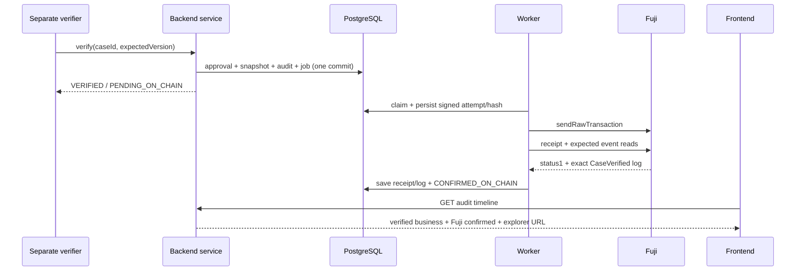

# Blockchain Architecture

Ngày tạo: 03/11/2026. Owner: C, reviewer B. Status: proposal, **chưa có contract/deployment/transaction thật**. Sources: PDF pp.8-13, Master Prompt §§7,12, user chọn backend signing.

## Những khái niệm cần học để làm task

| Concept | Ý nghĩa tối thiểu | AidBridge task / readiness |
|---|---|---|
| Blockchain | Shared append-only transaction history under consensus | Giải thích vì sao SQL và chain có thể tạm khác nhau; C01 |
| EVM | Runtime chạy bytecode Solidity | Compile/deploy registry trên local EVM rồi Fuji; C02-C04 |
| Avalanche C-Chain | EVM-compatible chain, không phải X/P-Chain | Adapter dùng Ethereum JSON-RPC đúng endpoint |
| Fuji | Testnet, chainId43113, test AVAX | Không dùng mainnet/private key có tài sản; C04 |
| Wallet/private key | Key ký tx; address nhận quyền và trả gas | Deploy admin riêng relayer; env secret không commit; C02 |
| Smart contract/Solidity | Code/state công khai, validation không đọc private DB | Registry chỉ guard relayer/org/refs/transitions, không verify household truth |
| Event/log | Receipt logs chứa structured audit signals | Decode exact ABI + eventId + commitment; C05/C08 |
| Tx hash | ID của signed transaction, không phải success proof | Persist local hash trước broadcast |
| Gas | Execution fee paid in test AVAX | Estimate, fee cap, faucet, monitor balance |
| RPC | Network API cho send/read | Timeout handling, chainId check, no account signing trên public node |
| Receipt | Execution outcome + block/log metadata | status success + expected event mới confirmed |
| On/off-chain | Public immutable small commitments vs private operational data | BR-08 tests calldata/events không PII |

## Tool choice

Chọn **Hardhat 3 + TypeScript tests**: một Node ecosystem có thể được F hỗ trợ; local node, deployment và typed ABI testing thuận tiện. Foundry có Solidity-native/fuzz tooling tốt nhưng thêm toolchain không cần thiết trong ba tuần. Không bắt nhóm học cả hai. Dùng OpenZeppelin AccessControl, không tự phát minh permissions/cryptography.

Node/Hardhat/Solidity patches và EVM target được pin tại setup, commit lockfile sau khi coding được phép. Compiler baseline 0.8.28, `evmVersion=paris`, optimizer enabled runs200; đúng setting phải được lưu để explorer verify. Không dùng OpenZeppelin component đòi compiler cao hơn pin mà không kiểm tra compatibility. Official: [Hardhat testing](https://hardhat.org/docs/guides/testing), [Node support](https://hardhat.org/docs/reference/nodejs-support), [OpenZeppelin](https://docs.openzeppelin.com/contracts/5.x/access-control).

## Trust boundary và authorization

- Deployer/admin key: chỉ deployment, org registration, grant/revoke. Không là routine backend signing key.
- Mỗi active demo organization có dedicated relayer address; secret giữ backend env/secret store. Một organization chính trong public demo; second org/user trong isolation tests.
- `DEFAULT_ADMIN_ROLE` quản lý organizationRef -> authorizedRelayer; `RELAYER_ROLE` cùng organization scope kiểm tra mọi business function. Address bị revoke không ghi được kể cả có orgRef cũ.
- Không gán một human contract role giả để tuyên bố independent user signatures. Backend xác thực user và BR-02/06; contract không đọc được identity đó.
- Backend compromise có thể tạo false assertions; chain giữ dấu vết signer, không ngăn operator/insider thông đồng. Random actor refs không giải quyết vấn đề này nên không public thêm identity metadata.
- Admin không có default permission ghi mọi business milestone; muốn relayer phải được explicit authorize. No payable functions, no token transfers, no arbitrary external calls.

## Proposed contract interface

Đây là interface specification, không Solidity implementation. Common envelope: `orgRef bytes32`, `caseRef bytes32`, `eventId bytes32`, `chainSequence uint64`, `evidenceCommitment bytes32`, `schemaVersion uint16=1`; operation-specific random refs bên dưới. Không public UUID nội bộ, string names, email, phone, quantities hoặc file URLs.

| Function | Caller / input bổ sung | Checks và minimal state | Event |
|---|---|---|---|
| registerOrganization | Admin; orgRef,relayer | nonzero unique org; allow grant/revoke/update via explicit admin operation; emit history | OrganizationRegistered / OrganizationRelayerUpdated |
| recordCaseVerification | Org relayer; envelope | org active, case not registered elsewhere, sequence1, commitment nonzero | CaseVerified |
| recordAidCommitment | Org relayer; envelope + commitmentRef | case verified, no open dispute, ref unique | AidCommitted |
| recordCommitmentReduction | Org relayer; envelope + commitmentRef | commitment exists same case/org; no business quantity math on-chain | CommitmentReduced |
| recordGoodsReceipt | Org relayer; envelope + receiptRef,commitmentRef | commitment exists same case/org; receiptRef unique | GoodsReceived |
| recordDelivery | Org relayer; envelope + deliveryRef | case verified, no open dispute, deliveryRef unique | DeliveryRecorded |
| confirmDelivery | Org relayer; envelope + deliveryRef | recorded same org/case, not confirmed/voided; case no dispute | DeliveryConfirmed |
| flagDispute | Org relayer; envelope + disputeRef,deliveryRef? | case exists; disputeRef unique; allows flag after confirmed delivery | DisputeFlagged |
| resolveDispute | Org relayer; envelope + disputeRef,resolution,deliveryRef? | open dispute, valid resolution; void only referenced delivery; decrement open count | DisputeResolved / DeliveryVoided |
| getEventRecord | Readonly; eventId | return type/org/case/payload digest/sequence, not full history | none |
| getCaseSummary | Readonly; caseRef | verified/openDisputeCount/lastChainSequence | none |

PA resolution ở API vẫn được backend org relayer ghi thay. Contract chỉ biết relayer authorization, không cryptographically prove PA signed resolution. Dispute resolution payload commitment giữ private reference đến authorized decision.

`getCaseEvents()` được thực hiện bằng filtered event logs ở backend, không unbounded storage array hoặc expensive on-chain history loop. Contract state tối thiểu: organization authorized mapping, case owner/verified/openDisputeCount/sequence, commitment refs, receipt refs, delivery status, dispute refs/status, processed eventId -> payload digest. Không on-chain campaign targets/stock math; đó là SQL business rules.

Mọi business event có chung indexed orgRef/caseRef/eventId, event type, related random ref, schemaVersion, chainSequence, commitment và block timestamp. Event names/types là stable API; ABI exported từ reviewed compile output cho Java decoding.

## Ordering, duplicate IDs và versioning

Case blockchain job được cấp `chainSequence` liên tục bắt đầu1; sequence cho on-chain milestones độc lập `audit_events.sequence_no` (local audit có thể xen kẽ). Job ghi dependency eventId của milestone trước. Worker chỉ gửi sau dependency confirmed; contract yêu cầu next sequence, ngăn replay/out-of-order. Org registration phải confirmed trước case event.

Random eventId 32 bytes được tạo khi DB commit và giữ qua retries; same ID/same digest contract reverts `EventAlreadyRecorded`, same ID/different digest `EventIdConflict`. Relayer authorization được check trước để không dùng lookup này tiết lộ private operator context. Worker khi gặp duplicate phải tìm original event/log và validate; không mark failed duplicate attempt thành confirmed. Logical job chỉ confirmed với **original successful tx** được đối chiếu.

Event schemaVersion=1 và domain version1. Thay manifest formatting/ABI phải test compatibility, không đổi payload của job đã PREPARED. Non-upgradeable registry: deploy version mới, preserve old deployment manifest/address/ABI và historical audit links; không rewrite old chain references. Không proxy/admin upgrade trong MVP.

## Evidence commitment scheme

1. Evidence file version lưu SHA-256 trên exact fixture bytes; immutable version metadata.
2. Business event manifest canonical JSON UTF-8: ASCII schema keys sorted lexicographically, no whitespace outside strings, no floats, integer decimal quantities, UUID/lowercase hex strings, UTC timestamps fixed millisecond format, string values normalized NFC before snapshot. Arrays goods/evidence sorted by their stable IDs. Fields: schemaVersion, eventId, random case/org refs, event type, private actor reference, record snapshot version, sorted goods lines, sorted evidence version records với sha256, server audit time. Không cần nhét tên/phone/address vào manifest; minimize ngay cả trước hash. Java/TS phải dùng cùng golden vector; không hash serialization mặc định của hai framework rồi giả định giống nhau.
3. `manifestDigest = SHA256(canonicalManifestBytes)`; dùng standard library, test Java/TS bằng shared fixture vectors.
4. Sinh secret random salt32 bytes/event bằng cryptographically secure RNG.
5. `commitment = keccak256(abi.encode(domainV1, chainId, registryAddress, caseRef, eventId, manifestDigest, salt))`.
6. Persist exact manifest, encrypted salt và commitment cùng job trước sign. Contract address phải đã biết; không tái tính cho deployment khác khi retry.

Không hash phone/name trực tiếp. Salt ngăn đoán nội dung low-entropy khi không tiết lộ salt; stable public orgRef/time/caseRef vẫn link được activity. Verifier muốn independently recompute phải có controlled disclosure của exact manifest+salt, không public mọi evidence. P0 demo có thể recompute private test vector; không full external evidence sharing portal. Hash chỉ cho thấy bytes/manifest khớp commitment, không authenticity hay consent validity.

Evidence changes tạo new version và new audit; không replace manifest đã anchored. Reviewed records bất biến, correction qua dispute/new reviewed record; evidence upload ngoài scope.

## Java integration và worker algorithm

Interface tối thiểu `BlockchainAdapter`: readChainId, prepareSignedTransaction, broadcastRawTransaction, getReceipt, readEventRecord, readLogs. Business modules chỉ ghi event/job; không gọi Web3j. Java dùng low-level ABI encoder và signed transaction preparation để có hash/bytes trước broadcast; không dùng blocking generated contract `.send()` trong request. [Web3j transaction managers](https://docs.web3j.io/4.14.0/smart_contracts/interacting_with_smart_contract/)

Submission loop proposal mỗi5 giây, bounded batch10; receipt loop mỗi5 giây; log reconciliation mỗi30 giây. RPC timeout10s; exponential transient retry5/15/60/300s và cap5m; pending lâu>10m là operator attention, không tự fail receipt. Rate limits/scheduling tunable env, không external queue.

1. Claim eligible job bằng lease30s trong short SQL transaction; expired lease có thể reclaim. One submission execution/signer; no network calls while locking business tables.
2. Verify chainId43113, registry bytecode/address, org registration and dependency event. Read existing processed event/log first khi recovery.
3. Với job chưa attempt, reserve signer nonce dùng signer-specific advisory lock và persisted journal; pending nonce phải đối chiếu known attempts, không overwrite nonce chưa rõ outcome.
4. Build gas limit bằng estimate + bounded safety margin; query dynamic fee parameters, apply configurable total fee cap. Không hardcode claim testnet always fast/cheap; thiếu test AVAX -> job pending/attention.
5. Sign local, compute txHash, persist encrypted signed bytes, nonce, chain/address, attempt PREPARED. Commit DB **trước** network broadcast.
6. Broadcast exact persisted bytes; save broadcast observation. Timeout ở đây -> UNKNOWN/pending; restart chỉ resend same bytes/hash.
7. Poll receipt ngoài SQL transaction. Success requires status=1, correct destination/contract, expected event type/eventId/org/case/sequence/commitment và canonical block reference theo RPC semantics. Malformed/mismatched receipt không confirmed.
8. Persist successful receipt/log observation và job CONFIRMED atomically, update sanitized audit sync projection. Never turn a reverted attempt into successful attempt.
9. Status0 -> attempt MINED_REVERT, job FAILED. Non-retryable auth/invalid transition alert operator; transient errors reschedule. Unknown/missing receipt stays pending.
10. Retry failed event only after reconcile. New nonce/attempt allowed when earlier attempt definitively mined reverted; retain all history. Automatic fee replacement dùng same nonce ngoài P0; pending lâu cần operator diagnosis/runbook.

Chỉ một in-flight tx/signer có thể block các case cùng organization khi pending lâu; đó là trade-off được chấp nhận cho demo nhỏ, không throughput architecture.

## Receipt verification, indexing và reconciliation

Fuji config: chainId43113; RPC `https://api.avax-test.network/ext/bc/C/rpc`. Explorer base configurable theo [Avalanche network docs](https://build.avax.network/docs/primary-network). Các public C-Chain nodes không giữ signing accounts; backend phải submit raw signed tx. [C-Chain RPC](https://docs.avax.network/docs/rpcs/c-chain)

Không giả định `txHash` hoặc arbitrary N Ethereum blocks là finality. Bám accepted/executed/finalized semantics của RPC được deployed network hỗ trợ; receipt và expected log phải có, block còn canonical. Document implementation check cụ thể tại C08 và chạy Fuji smoke; nếu provider không trả required block read, pending/attention thay vì fabricate confirmed.

Reconciler scan từ deploymentBlock/cursor bằng bounded ranges (default500 blocks); filter registry address/topics. Persist observations unique(chainId,txHash,logIndex) và cursor sau commit; overlap small recent range để replay an toàn. So sánh unknown logs với expected jobs, raise discrepancy; không tự tạo fake operational delivery từ unknown on-chain event. Event present nhưng local job pending -> verify context then repair sync projection. Local confirmed mất canonical reference -> mark discrepancy/pending và investigate, không xóa old observation.

## End-to-end verification example và failures

- Step send fails before broadcast: business remains VERIFIED, job pending/failed with reason; retry same event.
- Send timeout after accepted: same persisted txHash/bytes, query/rebroadcast; no new nonce until resolved.
- Fuji reverts: FAILED_ON_CHAIN; show business verification separately, investigate caller/state, retry only after reconcile.
- Receipt delayed: pending; no second logical event.
- Receipt received but SQL save fails: receipt/log reconciliation repairs projection after restart.
- Receipt success missing expected log: do not confirm; validate ABI/contract/network or detect duplicate original event.

## Contract task breakdown / tests

| Task | Business objective / concepts | Positive tests | Negative tests / completion |
|---|---|---|---|
| C01 | EVM/ABI/events/bytes32 commitments và trust limits | Shared manifest/ABI test vector agreed | Không PII fields; B/F review schema |
| C02 | Hardhat compile/local execution/secrets | Deterministic compile/test, separate accounts | No committed keys, unsupported chain fails config |
| C03 | Registration, access modifiers, case mapping/events | Authorized org registers/verifies, exact event | Unauthorized/admin-as-ungranted-relayer/wrong org/duplicate ID/zero hash revert |
| C04 | Deployment/gas/RPC/explorer | Fuji deployment receipt and code readable | Wrong chain fail before send; no fabricated address |
| C06 | Mappings, causal refs, disputes, enum transitions | Full pledge/receipt/delivery/confirm, resolve | Confirm missing/void/double delivery, open dispute, event ID conflict revert |
| C07/C08 | Durable signing/nonce/receipt jobs | Restart recovers persisted tx, log repair | Lost response, revert, wrong event, absent receipt never false confirmed |
| C10/C11 | SQL/contract coupling tests | Multi-item lifecycle anchors snapshots | Duplicate processing, wrong-org references, leaked metadata rejected |

## Fuji deployment / explorer runbook (future)

1. Pin toolchain/compiler/optimizer/EVM target/ABI; all local contract tests pass and B reviews permissions.
2. Generate dedicated test-only admin/relayer keys securely; record secret owner, fund via official test faucet, never mainnet funds.
3. Confirm chainId43113 and latest RPC operational status; estimate deploy fee/cap.
4. Deploy registry with explicit admin; save address, chainId, txHash, blockNumber, compiler settings, bytecode hash, ABI hash and contract version in deployment manifest.
5. Register approved org relayer, read back permissions; revoke/unauthorized tests trên local; safe negative Fuji test từ ungranted address khi cần.
6. Verify source trên supported explorer using exact compiler metadata; nếu verifier service unavailable, record limitation và giữ ABI/bytecode/deploy receipt, không nói source verified.
7. Record case verification tx, verify receipt+event with Java adapter, open explorer link in demo.
8. Backup encrypted key material và DB journal under authorized operator; không export keys vào README/video.

## Key compromise / outages

Admin revoke compromised relayer, suspend organization writes, stop worker, rotate test-only key, reconcile outstanding tx/nonces and record rotation event. Contract non-upgradeability không cản revoke; compromised admin nghiêm trọng hơn, redeploy new registry và retain old audit context. Secrets rotate after public demo; deployed chain history không thể xóa. Do not silently replay old signed tx against a new contract.
