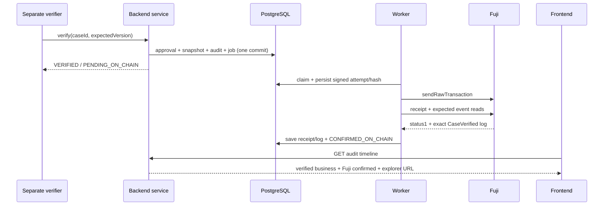

# Blockchain Architecture

Ngày tạo: 03/11/2026. Owner: C, reviewer B. Status: proposal, **chưa có contract/deployment/transaction thật**. Sources: PDF pp.8-13, Master Prompt §§7,12, user chọn backend signing.

## Những khái niệm cần học để làm task

| Concept | Ý nghĩa tối thiểu | AidBridge task / readiness |
|---|---|---|
| Blockchain | Shared append-only transaction history under consensus | Giải thích vì sao SQL và chain có thể tạm khác nhau; C01 |
| EVM | Runtime chạy bytecode Solidity | Compile/deploy registry trên local EVM rồi Fuji; C02-C04 |
| Avalanche C-Chain | EVM-compatible chain, không phải X/P-Chain | Adapter dùng Ethereum JSON-RPC đúng endpoint |
| Fuji | Testnet, chainId43113, test AVAX | Không dùng mainnet/private key có tài sản; C04 |
| Wallet/private key | Key ký tx; address nhận quyền và trả gas | Deploy admin riêng relayer; env secret không commit; C02 |
| Smart contract/Solidity | Code/state công khai, validation không đọc private DB | Registry chỉ guard relayer/org/refs/transitions, không verify household truth |
| Event/log | Receipt logs chứa structured audit signals | Decode exact ABI + eventId + commitment; C05/C08 |
| Tx hash | ID của signed transaction, không phải success proof | Persist local hash trước broadcast |
| Gas | Execution fee paid in test AVAX | Estimate, fee cap, faucet, monitor balance |
| RPC | Network API cho send/read | Timeout handling, chainId check, no account signing trên public node |
| Receipt | Execution outcome + block/log metadata | status success + expected event mới confirmed |
| On/off-chain | Public immutable small commitments vs private operational data | BR-08 tests calldata/events không PII |

## Tool choice

Chọn **Hardhat 3 + TypeScript tests**: một Node ecosystem có thể được F hỗ trợ; local node, deployment và typed ABI testing thuận tiện. Foundry có Solidity-native/fuzz tooling tốt nhưng thêm toolchain không cần thiết trong ba tuần. Không bắt nhóm học cả hai. Dùng OpenZeppelin AccessControl, không tự phát minh permissions/cryptography.

Node/Hardhat/Solidity patches và EVM target được pin tại setup, commit lockfile sau khi coding được phép. Compiler baseline 0.8.28, `evmVersion=paris`, optimizer enabled runs200; đúng setting phải được lưu để explorer verify. Không dùng OpenZeppelin component đòi compiler cao hơn pin mà không kiểm tra compatibility. Official: [Hardhat testing](https://hardhat.org/docs/guides/testing), [Node support](https://hardhat.org/docs/reference/nodejs-support), [OpenZeppelin](https://docs.openzeppelin.com/contracts/5.x/access-control).

## Trust boundary và authorization

- Deployer/admin key: chỉ deployment, org registration, grant/revoke. Không là routine backend signing key.
- Mỗi active demo organization có dedicated relayer address; secret giữ backend env/secret store. Một organization chính trong public demo; second org/user trong isolation tests.
- `DEFAULT_ADMIN_ROLE` quản lý organizationRef -> authorizedRelayer; `RELAYER_ROLE` cùng organization scope kiểm tra mọi business function. Address bị revoke không ghi được kể cả có orgRef cũ.
- Không gán một human contract role giả để tuyên bố independent user signatures. Backend xác thực user và BR-02/06; contract không đọc được identity đó.
- Backend compromise có thể tạo false assertions; chain giữ dấu vết signer, không ngăn operator/insider thông đồng. Random actor refs không giải quyết vấn đề này nên không public thêm identity metadata.
- Admin không có default permission ghi mọi business milestone; muốn relayer phải được explicit authorize. No payable functions, no token transfers, no arbitrary external calls.

## Proposed contract interface

Đây là interface specification, không Solidity implementation. Common envelope: `orgRef bytes32`, `caseRef bytes32`, `eventId bytes32`, `chainSequence uint64`, `evidenceCommitment bytes32`, `schemaVersion uint16=1`; operation-specific random refs bên dưới. Không public UUID nội bộ, string names, email, phone, quantities hoặc file URLs.

B01 consolidation04/11/2026: business audit event_type/function/Solidity event được đối chiếu tại [B01 initial event mapping](B01_BASELINE.md#4-initial-audit--contract-event-mapping), chờ Khoa review C01 trước freeze ABI. Canonical reduction audit type là COMMITMENT_REDUCED. HTTP auditEventId là audit row UUID, không phải random bytes32 eventId trên chain. registerOrganization là admin operation riêng không nhận caseRef/chainSequence giả; common envelope áp dụng cho case business milestones. Một resolveDispute với VOID_DELIVERY tạo đủ expected DeliveryVoided + DisputeResolved events trong cùng command/job, không tách thành hai SQL business commands trái thứ tự.

| Function | Caller / input bổ sung | Checks và minimal state | Event |
|---|---|---|---|
| registerOrganization | Admin; orgRef,relayer | nonzero unique org; allow grant/revoke/update via explicit admin operation; emit history | OrganizationRegistered / OrganizationRelayerUpdated |
| recordCaseVerification | Org relayer; envelope | org active, case not registered elsewhere, sequence1, commitment nonzero | CaseVerified |
| recordAidCommitment | Org relayer; envelope + commitmentRef | case verified, no open dispute, ref unique | AidCommitted |
| recordCommitmentReduction | Org relayer; envelope + commitmentRef | commitment exists same case/org; no business quantity math on-chain | CommitmentReduced |
| recordGoodsReceipt | Org relayer; envelope + receiptRef,commitmentRef | commitment exists same case/org; receiptRef unique | GoodsReceived |
| recordDelivery | Org relayer; envelope + deliveryRef | case verified, no open dispute, deliveryRef unique | DeliveryRecorded |
| confirmDelivery | Org relayer; envelope + deliveryRef | recorded same org/case, not confirmed/voided; case no dispute | DeliveryConfirmed |
| flagDispute | Org relayer; envelope + disputeRef,deliveryRef? | case exists; disputeRef unique; allows flag after confirmed delivery | DisputeFlagged |
| resolveDispute | Org relayer; envelope + disputeRef,resolution,deliveryRef? | open dispute, valid resolution; void only referenced delivery; decrement open count | DisputeResolved / DeliveryVoided |
| getEventRecord | Readonly; eventId | return type/org/case/payload digest/sequence, not full history | none |
| getCaseSummary | Readonly; caseRef | verified/openDisputeCount/lastChainSequence | none |

PA resolution ở API vẫn được backend org relayer ghi thay. Contract chỉ biết relayer authorization, không cryptographically prove PA signed resolution. Dispute resolution payload commitment giữ private reference đến authorized decision.

`getCaseEvents()` được thực hiện bằng filtered event logs ở backend, không unbounded storage array hoặc expensive on-chain history loop. Contract state tối thiểu: organization authorized mapping, case owner/verified/openDisputeCount/sequence, commitment refs, receipt refs, delivery status, dispute refs/status, processed eventId -> payload digest. Không on-chain campaign targets/stock math; đó là SQL business rules.

Mọi business event có chung indexed orgRef/caseRef/eventId, event type, related random ref, schemaVersion, chainSequence, commitment và block timestamp. Event names/types là stable API; ABI exported từ reviewed compile output cho Java decoding.

## Ordering, duplicate IDs và versioning

Case blockchain job được cấp `chainSequence` liên tục bắt đầu1; sequence cho on-chain milestones độc lập `audit_events.sequence_no` (local audit có thể xen kẽ). Job ghi dependency eventId của milestone trước. Worker chỉ gửi sau dependency confirmed; contract yêu cầu next sequence, ngăn replay/out-of-order. Org registration phải confirmed trước case event.

Random eventId 32 bytes được tạo khi DB commit và giữ qua retries; same ID/same digest contract reverts `EventAlreadyRecorded`, same ID/different digest `EventIdConflict`. Relayer authorization được check trước để không dùng lookup này tiết lộ private operator context. Worker khi gặp duplicate phải tìm original event/log và validate; không mark failed duplicate attempt thành confirmed. Logical job chỉ confirmed với **original successful tx** được đối chiếu.

Event schemaVersion=1 và domain version1. Thay manifest formatting/ABI phải test compatibility, không đổi payload của job đã PREPARED. Non-upgradeable registry: deploy version mới, preserve old deployment manifest/address/ABI và historical audit links; không rewrite old chain references. Không proxy/admin upgrade trong MVP.

## Evidence commitment scheme

1. Evidence file version lưu SHA-256 trên exact fixture bytes; immutable version metadata.
2. Business event manifest canonical JSON UTF-8: ASCII schema keys sorted lexicographically, no whitespace outside strings, no floats, integer decimal quantities, UUID/lowercase hex strings, UTC timestamps fixed millisecond format, string values normalized NFC before snapshot. Arrays goods/evidence sorted by their stable IDs. Fields: schemaVersion, eventId, random case/org refs, event type, private actor reference, record snapshot version, sorted goods lines, sorted evidence version records với sha256, server audit time. Không cần nhét tên/phone/address vào manifest; minimize ngay cả trước hash. Java/TS phải dùng cùng golden vector; không hash serialization mặc định của hai framework rồi giả định giống nhau.
3. `manifestDigest = SHA256(canonicalManifestBytes)`; dùng standard library, test Java/TS bằng shared fixture vectors.
4. Sinh secret random salt32 bytes/event bằng cryptographically secure RNG.
5. `commitment = keccak256(abi.encode(domainV1, chainId, registryAddress, caseRef, eventId, manifestDigest, salt))`.
6. Persist exact manifest, encrypted salt và commitment cùng job trước sign. Contract address phải đã biết; không tái tính cho deployment khác khi retry.

Không hash phone/name trực tiếp. Salt ngăn đoán nội dung low-entropy khi không tiết lộ salt; stable public orgRef/time/caseRef vẫn link được activity. Verifier muốn independently recompute phải có controlled disclosure của exact manifest+salt, không public mọi evidence. P0 demo có thể recompute private test vector; không full external evidence sharing portal. Hash chỉ cho thấy bytes/manifest khớp commitment, không authenticity hay consent validity.

Evidence changes tạo new version và new audit; không replace manifest đã anchored. Reviewed records bất biến, correction qua dispute/new reviewed record; evidence upload ngoài scope.

## Java integration và worker algorithm

Theo D44 và D45, `VerificationOutboxService` tra cứu quyết định qua `VerificationRepository` và dùng `AuditEventRepository`, `BlockchainJobRepository` để ghi `CASE_VERIFIED` cùng job `PENDING` trong transaction của caller. `payload_private` gồm `payloadVersion`, `verificationId` và `reviewedCaseVersion`. `event_key` dùng ID quyết định để chặn việc xếp cùng một approval hai lần. Đây là khóa SQL nội bộ. Worker cần tạo và lưu ID trên chain, deployment context và commitment khi chuẩn bị giao dịch, trước khi ký. Unit 2 sẽ gọi service từ luồng duyệt hồ sơ.

Interface tối thiểu `BlockchainAdapter`: readChainId, prepareSignedTransaction, broadcastRawTransaction, getReceipt, readEventRecord, readLogs. Business modules chỉ ghi event/job; không gọi Web3j. Java dùng low-level ABI encoder và signed transaction preparation để có hash/bytes trước broadcast; không dùng blocking generated contract `.send()` trong request. [Web3j transaction managers](https://docs.web3j.io/4.14.0/smart_contracts/interacting_with_smart_contract/)

Submission loop proposal mỗi5 giây, bounded batch10; receipt loop mỗi5 giây; log reconciliation mỗi30 giây. RPC timeout10s; exponential transient retry5/15/60/300s và cap5m; pending lâu>10m là operator attention, không tự fail receipt. Rate limits/scheduling tunable env, không external queue.

1. Claim eligible job bằng lease30s trong short SQL transaction; expired lease có thể reclaim. One submission execution/signer; no network calls while locking business tables.
2. Verify chainId43113, registry bytecode/address, org registration and dependency event. Read existing processed event/log first khi recovery.
3. Với job chưa attempt, reserve signer nonce dùng signer-specific advisory lock và persisted journal; pending nonce phải đối chiếu known attempts, không overwrite nonce chưa rõ outcome.
4. Build gas limit bằng estimate + bounded safety margin; query dynamic fee parameters, apply configurable total fee cap. Không hardcode claim testnet always fast/cheap; thiếu test AVAX -> job pending/attention.
5. Sign local, compute txHash, persist encrypted signed bytes, nonce, chain/address, attempt PREPARED. Commit DB **trước** network broadcast.
6. Broadcast exact persisted bytes; save broadcast observation. Timeout ở đây -> UNKNOWN/pending; restart chỉ resend same bytes/hash.
7. Poll receipt ngoài SQL transaction. Success requires status=1, correct destination/contract, expected event type/eventId/org/case/sequence/commitment và canonical block reference theo RPC semantics. Malformed/mismatched receipt không confirmed.
8. Persist successful receipt/log observation và job CONFIRMED atomically, update sanitized audit sync projection. Never turn a reverted attempt into successful attempt.
9. Status0 -> attempt MINED_REVERT, job FAILED. Non-retryable auth/invalid transition alert operator; transient errors reschedule. Unknown/missing receipt stays pending.
10. Retry failed event only after reconcile. New nonce/attempt allowed when earlier attempt definitively mined reverted; retain all history. Automatic fee replacement dùng same nonce ngoài P0; pending lâu cần operator diagnosis/runbook.

Chỉ một in-flight tx/signer có thể block các case cùng organization khi pending lâu; đó là trade-off được chấp nhận cho demo nhỏ, không throughput architecture.

## Receipt verification, indexing và reconciliation

Fuji config: chainId43113; RPC `https://api.avax-test.network/ext/bc/C/rpc`. Explorer base configurable theo [Avalanche network docs](https://build.avax.network/docs/primary-network). Các public C-Chain nodes không giữ signing accounts; backend phải submit raw signed tx. [C-Chain RPC](https://docs.avax.network/docs/rpcs/c-chain)

Không giả định `txHash` hoặc arbitrary N Ethereum blocks là finality. Bám accepted/executed/finalized semantics của RPC được deployed network hỗ trợ; receipt và expected log phải có, block còn canonical. Document implementation check cụ thể tại C08 và chạy Fuji smoke; nếu provider không trả required block read, pending/attention thay vì fabricate confirmed.

Reconciler scan từ deploymentBlock/cursor bằng bounded ranges (default500 blocks); filter registry address/topics. Persist observations unique(chainId,txHash,logIndex) và cursor sau commit; overlap small recent range để replay an toàn. So sánh unknown logs với expected jobs, raise discrepancy; không tự tạo fake operational delivery từ unknown on-chain event. Event present nhưng local job pending -> verify context then repair sync projection. Local confirmed mất canonical reference -> mark discrepancy/pending và investigate, không xóa old observation.

## End-to-end verification example và failures



- Step send fails before broadcast: business remains VERIFIED, job pending/failed with reason; retry same event.
- Send timeout after accepted: same persisted txHash/bytes, query/rebroadcast; no new nonce until resolved.
- Fuji reverts: FAILED_ON_CHAIN; show business verification separately, investigate caller/state, retry only after reconcile.
- Receipt delayed: pending; no second logical event.
- Receipt received but SQL save fails: receipt/log reconciliation repairs projection after restart.
- Receipt success missing expected log: do not confirm; validate ABI/contract/network or detect duplicate original event.

## CASE_VERIFIED Design Fixture & ABI Review Bundle (Bàn giao cho Khoa - C01/C03/C05)

Status: **DESIGN FIXTURE (Proposed / Mock Data for C01/C03/C05 Review)** — dùng dữ liệu giả lập (fictional data), chưa phải bằng chứng giao dịch đã chạy trên Fuji. Toàn bộ digest và commitment chưa tính từ runtime thực tế được gắn nhãn `<PLACEHOLDER_...>`.

### 1. Kịch bản giả lập (Fictional Scenario)

- **Organization:** `org-central-relief` (`organizationId = 11111111-1111-4111-8111-111111111111`, status `APPROVED`).
- **Creator (User A - `VOLUNTEER`):** `userAId = aaaaaaaa-aaaa-4aaa-8aaa-aaaaaaaaaaaa` tạo hồ sơ tại `version = 0` (`status = SUBMITTED`).
- **Verifier (User B - `VERIFIER`):** `userBId = bbbbbbbb-bbbb-4bbb-8bbb-bbbbbbbbbbbb` (khác User A theo `BR-02`) duyệt hồ sơ tại `expectedVersion = 0` với đầy đủ danh sách `reviewedEvidenceVersionIds` hiện hành.

### 2. Private Fixture (Off-Chain Only — Tuyệt đối không đưa lên chuỗi)

#### 2.1. Layer 1: Decision, Reviewed Case Revision (`D43`) & Evidence Versions (`V5`/`V6`/`V8`)

```json
{
  "fixtureLabel": "DESIGN_FIXTURE_ONLY",
  "decisionRecord": {
    "verificationId": "77777777-7777-4777-8777-777777777777",
    "aidCaseId": "22222222-2222-4222-8222-222222222222",
    "verifierId": "bbbbbbbb-bbbb-4bbb-8bbb-bbbbbbbbbbbb",
    "decision": "APPROVED",
    "reviewedCaseVersion": 0,
    "verifiedAt": "2026-11-09T01:00:00.000Z"
  },
  "reviewedCaseRevisionRow": {
    "id": "66666666-6666-4666-8666-666666666666",
    "organizationId": "11111111-1111-4111-8111-111111111111",
    "aidCaseId": "22222222-2222-4222-8222-222222222222",
    "caseVersion": 0,
    "createdAt": "2026-11-09T00:30:00.000Z",
    "snapshotPrivate": {
      "id": "22222222-2222-4222-8222-222222222222",
      "organizationId": "11111111-1111-4111-8111-111111111111",
      "creator": {
        "id": "aaaaaaaa-aaaa-4aaa-8aaa-aaaaaaaaaaaa",
        "fullName": "Fictional Volunteer A"
      },
      "beneficiaryAlias": "SIM-HH-QUANG-BINH-01",
      "internalTitle": "Emergency flood food and water support for simulated household 01",
      "publicTitle": "Flood relief package for household SIM-HH-QUANG-BINH-01",
      "publicSummary": "Simulated household needs rice and clean water after flooding.",
      "approximateArea": "Le Thuy District (Simulated)",
      "priority": "URGENT",
      "status": "SUBMITTED",
      "version": 0,
      "needs": [
        {
          "id": "33333333-3333-4333-8333-333333333331",
          "name": "Rice",
          "unit": "kg",
          "quantity": 20
        },
        {
          "id": "33333333-3333-4333-8333-333333333332",
          "name": "Drinking Water",
          "unit": "box",
          "quantity": 4
        }
      ],
      "consent": {
        "id": "44444444-4444-4444-8444-444444444444",
        "basis": "CONSENT",
        "scope": "CASE_VERIFICATION_AND_PUBLIC_SUMMARY",
        "capturedAt": "2026-11-09T00:15:00.000Z",
        "publicSummaryAllowed": true
      },
      "evidenceVersions": [
        {
          "id": "55555555-5555-4555-8555-555555555551",
          "evidenceFileId": "55555555-0000-4555-8555-555555555551",
          "versionNo": 1,
          "mimeType": "text/plain",
          "byteSize": 128,
          "sha256": "1111111111111111111111111111111111111111111111111111111111111111",
          "createdAt": "2026-11-09T00:25:00.000Z"
        },
        {
          "id": "55555555-5555-4555-8555-555555555552",
          "evidenceFileId": "55555555-0000-4555-8555-555555555552",
          "versionNo": 1,
          "mimeType": "text/plain",
          "byteSize": 256,
          "sha256": "2222222222222222222222222222222222222222222222222222222222222222",
          "createdAt": "2026-11-09T00:26:00.000Z"
        }
      ],
      "createdAt": "2026-11-09T00:20:00.000Z",
      "updatedAt": "2026-11-09T00:20:00.000Z",
      "submittedAt": "2026-11-09T00:20:00.000Z",
      "supersedesCaseId": null
    }
  },
  "offChainOnlyEvidenceAccess": [
    {
      "evidenceVersionId": "55555555-5555-4555-8555-555555555551",
      "fixtureKey": "org1-household-intake-v1",
      "privateAuthenticatedPath": "/api/evidence-versions/55555555-5555-4555-8555-555555555551/content"
    },
    {
      "evidenceVersionId": "55555555-5555-4555-8555-555555555552",
      "fixtureKey": "org1-damage-checklist-v1",
      "privateAuthenticatedPath": "/api/evidence-versions/55555555-5555-4555-8555-555555555552/content"
    }
  ]
}
```

#### 2.2. Layer 2: SQL Outbox Rows (`D44`/`D45` Current Code vs Proposed Worker Preparation)

```json
{
  "currentCodeSqlRows": {
    "auditEventsRow": {
      "id": "88888888-8888-4888-8888-888888888888",
      "organization_id": "11111111-1111-4111-8111-111111111111",
      "aid_case_id": "22222222-2222-4222-8222-222222222222",
      "actor_user_id": "bbbbbbbb-bbbb-4bbb-8bbb-bbbbbbbbbbbb",
      "entity_type": "VERIFICATION",
      "entity_id": "77777777-7777-4777-8777-777777777777",
      "event_type": "CASE_VERIFIED",
      "event_key": "77777777-7777-4777-8777-777777777777",
      "payload_private": {
        "payloadVersion": 1,
        "verificationId": "77777777-7777-4777-8777-777777777777",
        "reviewedCaseVersion": 0
      },
      "public_metadata": {},
      "evidence_commitment": null,
      "occurred_at": "2026-11-09T01:00:00.000Z"
    },
    "blockchainJobsRow": {
      "id": "99999999-9999-4999-8999-999999999999",
      "audit_event_id": "88888888-8888-4888-8888-888888888888",
      "chain_id": 43113,
      "status": "PENDING",
      "retry_count": 0,
      "next_retry_at": null,
      "last_error": null,
      "created_at": "2026-11-09T01:00:00.000Z",
      "updated_at": "2026-11-09T01:00:00.000Z"
    },
    "httpDecisionResponse": {
      "verificationId": "77777777-7777-4777-8777-777777777777",
      "caseId": "22222222-2222-4222-8222-222222222222",
      "decision": "APPROVED",
      "caseStatus": "VERIFIED",
      "caseVersion": 1,
      "reviewerId": "bbbbbbbb-bbbb-4bbb-8bbb-bbbbbbbbbbbb",
      "reviewedAt": "2026-11-09T01:00:00.000Z",
      "auditEventId": "88888888-8888-4888-8888-888888888888",
      "blockchainStatus": "PENDING_ON_CHAIN"
    }
  },
  "workerPreparationPrivateData": {
    "status": "PROPOSED_WORKER_PREPARATION_BEFORE_SIGNING",
    "encryptedSalt32BytesHex": "<PLACEHOLDER_32_BYTE_CSPRNG_SALT_HEX_OFF_CHAIN_ONLY>",
    "canonicalManifestJsonPreview": {
      "actorRef": "<PLACEHOLDER_PRIVATE_ACTOR_REF_FOR_USER_B>",
      "caseRef": "0x2020202020202020202020202020202020202020202020202020202020202020",
      "eventId": "0x3030303030303030303030303030303030303030303030303030303030303030",
      "eventType": "CASE_VERIFIED",
      "evidenceVersions": [
        {
          "evidenceVersionId": "55555555-5555-4555-8555-555555555551",
          "sha256": "1111111111111111111111111111111111111111111111111111111111111111",
          "versionNo": 1
        },
        {
          "evidenceVersionId": "55555555-5555-4555-8555-555555555552",
          "sha256": "2222222222222222222222222222222222222222222222222222222222222222",
          "versionNo": 1
        }
      ],
      "goodsLines": [
        {
          "itemId": "33333333-3333-4333-8333-333333333331",
          "quantity": 20,
          "unit": "kg"
        },
        {
          "itemId": "33333333-3333-4333-8333-333333333332",
          "quantity": 4,
          "unit": "box"
        }
      ],
      "occurredAt": "2026-11-09T01:00:00.000Z",
      "orgRef": "0x1010101010101010101010101010101010101010101010101010101010101010",
      "reviewedCaseVersion": 0,
      "schemaVersion": 1,
      "verificationId": "77777777-7777-4777-8777-777777777777"
    },
    "manifestDigestSha256": "<PLACEHOLDER_SHA256_OF_CANONICAL_MANIFEST_BYTES>",
    "commitmentFormula": "keccak256(abi.encode(domainV1, 43113, registryAddress, caseRef, eventId, manifestDigest, salt))"
  }
}
```

### 3. Public On-Chain Envelope (`Layer 3` — Calldata & Expected Event)

```json
{
  "fixtureLabel": "DESIGN_FIXTURE_PUBLIC_ENVELOPE",
  "preconditions": {
    "chainId": 43113,
    "registryAddress": "0x000000000000000000000000000000000000c0de",
    "organizationRegistered": true,
    "orgRef": "0x1010101010101010101010101010101010101010101010101010101010101010",
    "authorizedOrgRelayer": "0x000000000000000000000000000000000000beef"
  },
  "contractCallInput": {
    "function": "recordCaseVerification(bytes32 orgRef, bytes32 caseRef, bytes32 eventId, uint64 chainSequence, bytes32 evidenceCommitment, uint16 schemaVersion)",
    "caller": "0x000000000000000000000000000000000000beef",
    "arguments": {
      "orgRef": "0x1010101010101010101010101010101010101010101010101010101010101010",
      "caseRef": "0x2020202020202020202020202020202020202020202020202020202020202020",
      "eventId": "0x3030303030303030303030303030303030303030303030303030303030303030",
      "chainSequence": 1,
      "evidenceCommitment": "<PLACEHOLDER_32_BYTE_KECCAK256_COMMITMENT_NONZERO>",
      "schemaVersion": 1
    }
  },
  "expectedEmittedEvent": {
    "eventName": "CaseVerified",
    "indexedTopics": {
      "orgRef": "0x1010101010101010101010101010101010101010101010101010101010101010",
      "caseRef": "0x2020202020202020202020202020202020202020202020202020202020202020",
      "eventId": "0x3030303030303030303030303030303030303030303030303030303030303030"
    },
    "dataFields": {
      "chainSequence": 1,
      "evidenceCommitment": "<PLACEHOLDER_32_BYTE_KECCAK256_COMMITMENT_NONZERO>",
      "schemaVersion": 1,
      "blockTimestamp": "<PLACEHOLDER_BLOCK_TIMESTAMP_UINT64>"
    }
  },
  "expectedContractStateAfterCall": {
    "getCaseSummary(caseRef)": {
      "verified": true,
      "openDisputeCount": 0,
      "lastChainSequence": 1
    },
    "getEventRecord(eventId)": {
      "orgRef": "0x1010101010101010101010101010101010101010101010101010101010101010",
      "caseRef": "0x2020202020202020202020202020202020202020202020202020202020202020",
      "chainSequence": 1,
      "evidenceCommitment": "<PLACEHOLDER_32_BYTE_KECCAK256_COMMITMENT_NONZERO>"
    }
  }
}
```

### 4. Bảng ánh xạ 3 tầng (Three-Layer Mapping Table)

| Khái niệm / Trường dữ liệu | Layer 1: Decision & Snapshot (`verifications` / `case_revisions`) | Layer 2: SQL Outbox (`audit_events` / `blockchain_jobs`) | Layer 3: On-Chain (`recordCaseVerification` / `CaseVerified`) | Trạng thái trong Code / SQL hiện tại (`D43`–`D45`, `V5`–`V8`) |
|---|---|---|---|---|
| **ID dòng Audit nội bộ** | Không lưu trong `verifications` | `audit_events.id` (UUID) = `blockchain_jobs.audit_event_id` = `DecisionResponse.auditEventId` | **Off-chain only** | **Đã có** trong `V5`, `AuditEvent.id`, `BlockchainJob.auditEvent`, `VerificationOutboxService`. |
| **Khóa chống trùng sự kiện SQL (`event_key`)** | `verifications.id` (`verificationId` UUID) | `audit_events.event_key` (UUID `UNIQUE`, gán bằng `verificationId`) | **Off-chain only** | **Đã có** trong `V5`, `AuditEvent.eventKey`, `VerificationOutboxService`. |
| **ID sự kiện trên chuỗi (`eventId`)** | Không có | Chưa có cột riêng trong `V5`; worker tạo random `bytes32` và giữ cố định qua các lần retry | `eventId` (`bytes32`, indexed) | **Worker/schema cần chuẩn bị** trước khi ký ở `C05`/`C07`. |
| **Tham chiếu Tổ chức (`orgRef`)** | `aid_cases.organization_id` (UUID nội bộ) | `audit_events.organization_id` (UUID nội bộ) | `orgRef` (`bytes32`, indexed) | UUID nội bộ **đã có**; `public_ref` (`bytes32`) và `relayer_address` trên `organizations` **cần forward migration / worker đọc**. |
| **Tham chiếu Hồ sơ (`caseRef`)** | `aid_cases.id` (UUID nội bộ) | `audit_events.aid_case_id` (UUID nội bộ) | `caseRef` (`bytes32`, indexed) | UUID nội bộ **đã có**; `caseRef` (`bytes32`) **cần worker/schema lưu cố định theo hồ sơ** trước khi ký. |
| **Bản chụp hồ sơ được duyệt (`reviewedCaseVersion`)** | `verifications.reviewed_case_version = 0` tham chiếu FK `(aid_case_id, case_version)` tới `case_revisions.snapshot_private` (`V8`, `D43`) | `audit_events.payload_private.reviewedCaseVersion = 0` (`D44`) | **Off-chain only** (đi vào canonical manifest trước khi băm `manifestDigest`) | **Đã có** trong `V6`, `V8`, `Verification`, `CaseRevision`, `VerificationOutboxService`. |
| **Danh sách bằng chứng được duyệt** | `snapshot_private.evidenceVersions[*].{id, versionNo, sha256}` | Worker đọc từ `case_revisions.snapshot_private` theo `(aid_case_id, reviewedCaseVersion)` | **Off-chain only** (chỉ `evidenceCommitment` `bytes32` lên chuỗi) | Kiểm tra lúc duyệt và lưu trong `case_revisions` **đã có**; bước dựng canonical manifest + salt + `evidenceCommitment` **thuộc worker chuẩn bị**. |
| **Cam kết bằng chứng (`evidenceCommitment`)** | Không có | `audit_events.evidence_commitment` (`CHAR(64)` nullable trong `V5`, nhưng `audit_events` có trigger immutable ở `V6`) | `evidenceCommitment` (`bytes32`, phải khác `0x00..00`) | **Worker/schema cần chuẩn bị** (lưu trên `blockchain_jobs` để không chạm trigger immutable của `audit_events`). |
| **Thứ tự mốc trên chuỗi (`chainSequence`)** | Không có | Chưa có trong `V5` `blockchain_jobs` | `chainSequence` (`uint64 = 1` cho `CASE_VERIFIED`) | **Worker/schema cần chuẩn bị** (`chainSequence = 1` cho mốc đầu tiên của hồ sơ). |
| **Phiên bản schema (`schemaVersion`)** | Không có | `payload_private.payloadVersion = 1` | `schemaVersion` (`uint16 = 1`) | `payloadVersion = 1` **đã có** trong `VerificationOutboxService`; tham số `uint16 schemaVersion = 1` **worker truyền khi encode ABI**. |

### 5. Kịch bản kiểm thử Dương (First Write) & Âm (Negative / Retry Cases)

| Mã kịch bản | Đầu vào / Điều kiện gọi `recordCaseVerification` | Hành vi kỳ vọng trên Contract & Worker |
|---|---|---|
| **POS-01: First Write hợp lệ** | `orgRef` đã được Admin đăng ký với `authorizedOrgRelayer`; caller = `authorizedOrgRelayer`; `caseRef` chưa từng xuất hiện; `chainSequence = 1`; `schemaVersion = 1`; `evidenceCommitment != 0x0`; `eventId` mới. | Contract lưu state (`verified = true`, `lastChainSequence = 1`, lưu `eventId -> digest`), phát sự kiện `CaseVerified`. Worker đối chiếu receipt `status = 1` + đúng log `CaseVerified` rồi mới chuyển job sang `CONFIRMED`. |
| **NEG-01a: Sai Relayer hoặc Admin gọi trực tiếp** | `orgRef` đã đăng ký cho Relayer A, nhưng người gọi là Relayer của tổ chức khác, địa chỉ lạ, đã bị revoke, hoặc chính `DEFAULT_ADMIN_ROLE` chưa được cấp quyền relayer cho `orgRef` đó. | Contract **revert ngay ở bước kiểm tra quyền đầu tiên** (`UnauthorizedRelayer`), không tiết lộ trạng thái `eventId` hay `caseRef` bên trong. |
| **NEG-01b: Tổ chức chưa đăng ký hoặc Case thuộc Org khác** | `orgRef` chưa đăng ký/đang bị thu hồi, hoặc `caseRef` đã được neo trước đó dưới một `orgRef` khác. | Contract **revert** (`OrganizationNotActive` / `CaseOrganizationMismatch`). |
| **NEG-02: Sai `chainSequence`** | Gửi `recordCaseVerification` cho hồ sơ mới nhưng `chainSequence = 0` hoặc `chainSequence = 2` (khác `1`), hoặc gọi lại `recordCaseVerification` khi hồ sơ đã ở `lastChainSequence >= 1` với `eventId` mới. | Contract **revert** (`InvalidChainSequence` / `CaseAlreadyVerified`). Mốc mở đầu của một `caseRef` bắt buộc `chainSequence == 1`. |
| **NEG-03a: Trùng `eventId` cùng digest (`Same-Digest Duplicate` khi Worker Retry)** | Worker gửi lại cùng `eventId` (`0x3030..30`) và cùng toàn bộ tham số sau khi lần gửi trước thực chất đã được mine nhưng worker bị timeout/restart. | Contract **revert `EventAlreadyRecorded`**. Worker **không** sinh `eventId` mới và **không** đánh dấu giao dịch revert thứ hai là confirmed; worker dùng `readEventRecord`/`readLogs` tìm lại giao dịch gốc đã thành công, kiểm tra khớp `eventId` + `evidenceCommitment`, rồi gắn job `CONFIRMED` theo giao dịch gốc. |
| **NEG-03b: Trùng `eventId` khác digest (`Conflicting-Digest Duplicate`)** | Gửi cùng `eventId` (`0x3030..30`) đã từng được ghi nhận trên chuỗi, nhưng thay đổi `evidenceCommitment`, `caseRef`, `orgRef` hoặc `chainSequence`. | Contract **revert `EventIdConflict`**. Worker đánh dấu lỗi nghiêm trọng (data/signing integrity mismatch), giữ nguyên lịch sử attempt và dừng tự động tạo payload mới cho job đó để kiểm tra. |

### 6. Quyết định đã chốt (`D48` - Phương án A) và 3 điểm ABI Khoa xác nhận khi code `C01`/`C03`

**Đã chốt bởi Dũng (`D48` - Phương án A, 09/11/2026):**
- **Không sửa code Backend của `B05` ở bước chốt thiết kế này:** Giữ nguyên `audit_events` và `AuditEvent.java` hoàn toàn bất biến (`@Immutable` và trigger `audit_events_immutable` trong `V6`).
- **Quy hoạch Forward Migration `V9` (khi triển khai Worker ở `C05`/`C07`):**
  - `organizations`: thêm `public_ref BYTEA UNIQUE` (32 bytes) và `relayer_address VARCHAR(42)`.
  - `aid_cases`: thêm `public_ref BYTEA UNIQUE` (32 bytes).
  - `blockchain_jobs`: thêm `logical_event_id BYTEA UNIQUE` (32 bytes, sinh bằng `SecureRandom` và giữ cố định qua mọi lần retry), `chain_sequence BIGINT` (`= 1` cho `CASE_VERIFIED`, `UNIQUE(aid_case_id, chain_sequence)`), `schema_version SMALLINT DEFAULT 1`, `manifest_private JSONB`, `salt_ciphertext BYTEA`, `evidence_commitment BYTEA` (32 bytes), `lease_until TIMESTAMPTZ`.
  - `blockchain_transactions`: thêm `contract_address VARCHAR(42)`, `signer_address VARCHAR(42)`, `nonce BIGINT`, `signed_tx_ciphertext BYTEA`, `receipt_private JSONB`, `UNIQUE(chain_id, signer_address, nonce)` và trạng thái `PREPARED` trước khi broadcast.

**Ba điểm ABI trên Solidity Khoa lưu ý giữ đúng khi viết `AidRegistry.sol` (`C01`/`C03`):**
1. **Chữ ký sự kiện `CaseVerified` và `getEventRecord`:** Giữ thứ tự tham số và các trường `indexed` của `CaseVerified` (`orgRef`, `caseRef`, `eventId` là 3 `indexed bytes32`, phần data gồm `uint64 chainSequence`, `bytes32 evidenceCommitment`, `uint16 schemaVersion`, `uint64 timestamp`) để khớp bộ giải mã log Web3j.
2. **Kiểu dữ liệu `domainV1` trong công thức `evidenceCommitment`:** Thống nhất `domainV1` (`bytes32` hằng số `keccak256("AIDBRIDGE_EVIDENCE_V1")` hoặc `uint16 = 1`) giữa Java và TypeScript khi tạo golden vector.
3. **Cách tính digest lưu trong `processed eventId -> payload digest` trên Contract:** Khi phân biệt `EventAlreadyRecorded` với `EventIdConflict`, thống nhất so sánh `keccak256(abi.encode(orgRef, caseRef, chainSequence, evidenceCommitment, schemaVersion))` (hoặc `evidenceCommitment`) trong test `C03`.

## Contract task breakdown / tests

| Task | Business objective / concepts | Positive tests | Negative tests / completion |
|---|---|---|---|
| C01 | EVM/ABI/events/bytes32 commitments và trust limits | Shared manifest/ABI test vector agreed | Không PII fields; B/F review schema |
| C02 | Hardhat compile/local execution/secrets | Deterministic compile/test, separate accounts | No committed keys, unsupported chain fails config |
| C03 | Registration, access modifiers, case mapping/events | Authorized org registers/verifies, exact event | Unauthorized/admin-as-ungranted-relayer/wrong org/duplicate ID/zero hash revert |
| C04 | Deployment/gas/RPC/explorer | Fuji deployment receipt and code readable | Wrong chain fail before send; no fabricated address |
| C06 | Mappings, causal refs, disputes, enum transitions | Full pledge/receipt/delivery/confirm, resolve | Confirm missing/void/double delivery, open dispute, event ID conflict revert |
| C07/C08 | Durable signing/nonce/receipt jobs | Restart recovers persisted tx, log repair | Lost response, revert, wrong event, absent receipt never false confirmed |
| C10/C11 | SQL/contract coupling tests | Multi-item lifecycle anchors snapshots | Duplicate processing, wrong-org references, leaked metadata rejected |

## Fuji deployment / explorer runbook (future)

1. Pin toolchain/compiler/optimizer/EVM target/ABI; all local contract tests pass and B reviews permissions.
2. Generate dedicated test-only admin/relayer keys securely; record secret owner, fund via official test faucet, never mainnet funds.
3. Confirm chainId43113 and latest RPC operational status; estimate deploy fee/cap.
4. Deploy registry with explicit admin; save address, chainId, txHash, blockNumber, compiler settings, bytecode hash, ABI hash and contract version in deployment manifest.
5. Register approved org relayer, read back permissions; revoke/unauthorized tests trên local; safe negative Fuji test từ ungranted address khi cần.
6. Verify source trên supported explorer using exact compiler metadata; nếu verifier service unavailable, record limitation và giữ ABI/bytecode/deploy receipt, không nói source verified.
7. Record case verification tx, verify receipt+event with Java adapter, open explorer link in demo.
8. Backup encrypted key material và DB journal under authorized operator; không export keys vào README/video.

## Key compromise / outages

Admin revoke compromised relayer, suspend organization writes, stop worker, rotate test-only key, reconcile outstanding tx/nonces and record rotation event. Contract non-upgradeability không cản revoke; compromised admin nghiêm trọng hơn, redeploy new registry và retain old audit context. Secrets rotate after public demo; deployed chain history không thể xóa. Do not silently replay old signed tx against a new contract.
