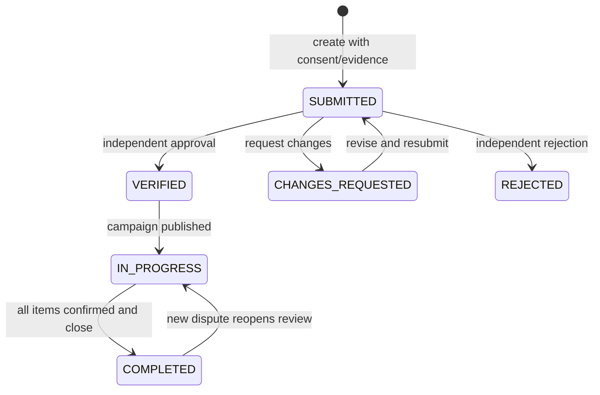
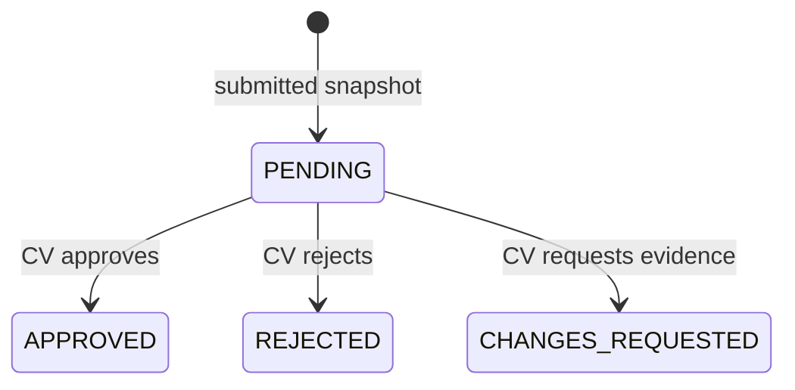
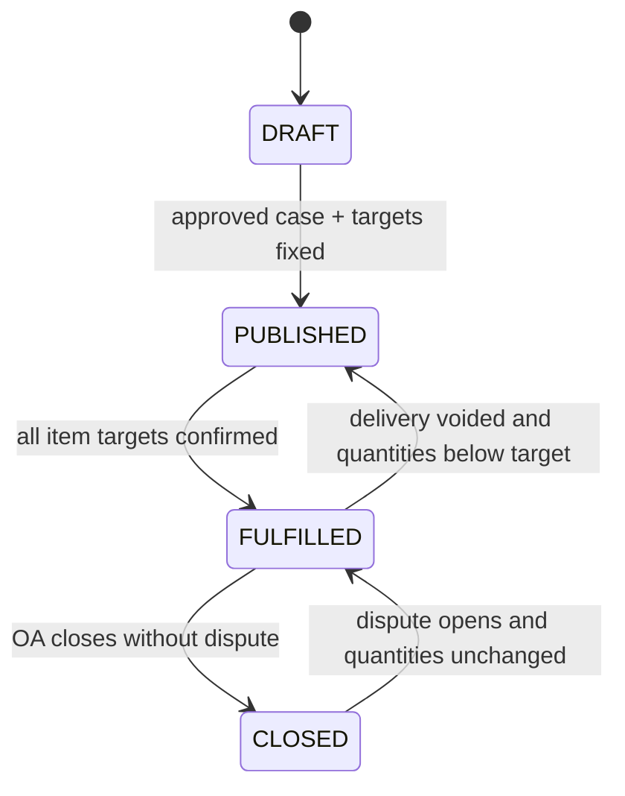
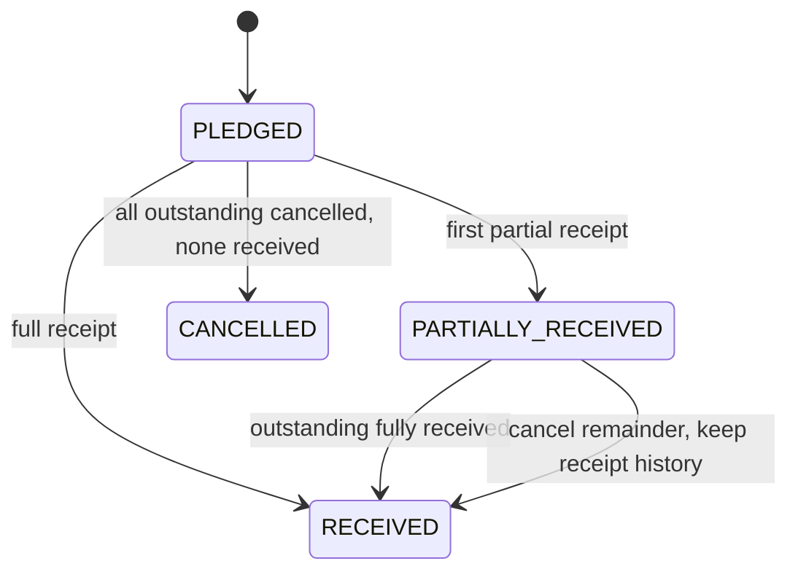
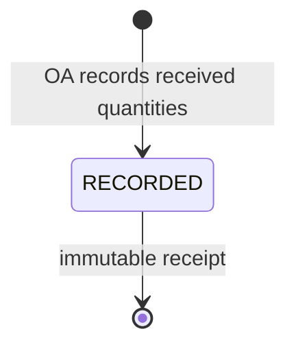
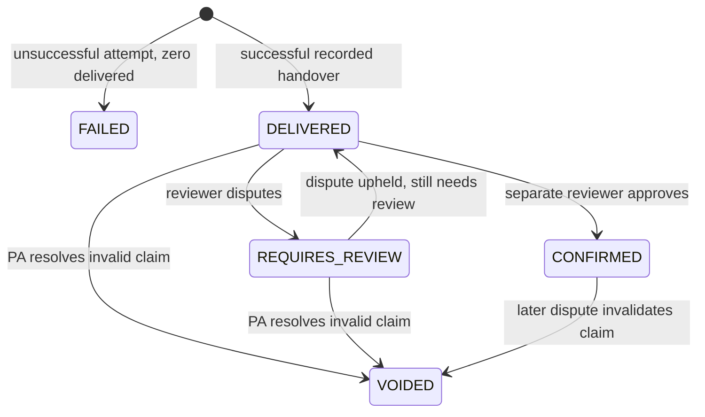
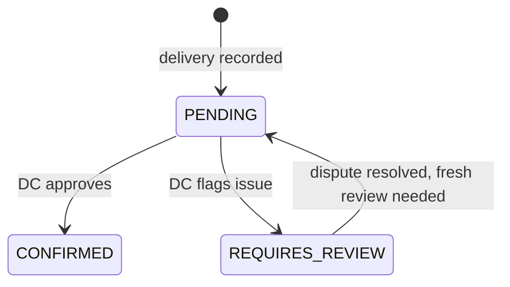
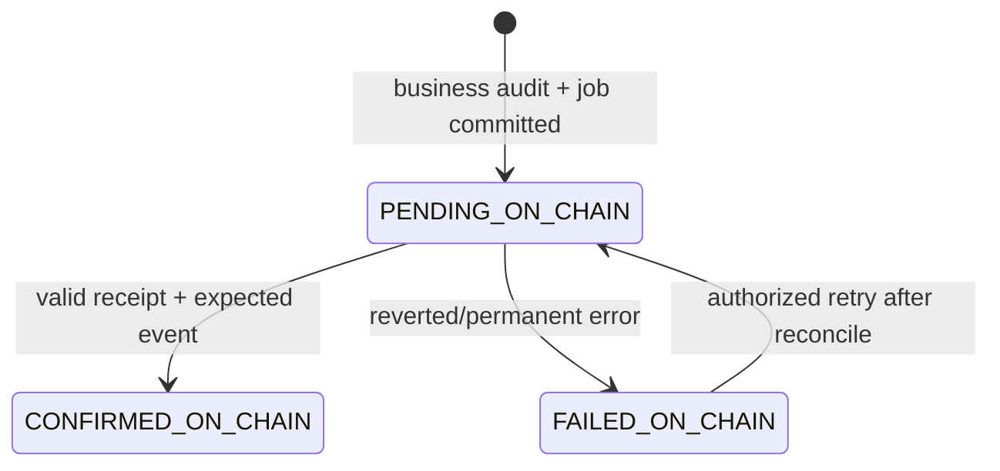

# Business Workflows

Ngày tạo: 03/11/2026. Cập nhật:04/11/2026. Owner: B. Status: baseline thống nhất, In Review theo [B01](B01_BASELINE.md). SOURCE bắt buộc: PDF pp.5-8,13-16,20. State diagrams là target behavior; không coi placeholders V2–V5 là schema đã có.

## Actors, ownership và invariants

Abbreviations: FV=VOLUNTEER, CV=VERIFIER, OA=ORG_ADMIN, DC=DELIVERY_CONFIRMER, PA=PLATFORM_ADMIN. OA/FV/CV/DC là membership roles đúng tên CHECK trong V1; PA là platform role. Tất cả organization actors cần user.status=ACTIVE và membership.status=ACTIVE ở owning org. Donor cần account ACTIVE và explicit donorEnabled grant; chỉ mutation contribution của mình. donor_enabled chưa có trong V1/User, cần forward migration/mapping trước donor endpoints. PA không bypass donor grant, BR-02/06 hoặc đọc PII mặc định; public reads qua sanitized projection.

Organization phải APPROVED cho operational writes. SUSPENDED org không nhận pledge/mutation mới và được loại khỏi public browse; historical public audit vẫn có thể đọc theo sanitized policy. Platform Admin suspension phải phối hợp revoke relayer; backend guard chặn trước cả khi chain revocation chưa hoàn tất.

| Action | Actor | Resource/state guards |
|---|---|---|
| Create/update case | FV | Own org; editable case; actor từ session |
| Approve/reject/request changes | CV | Own org; SUBMITTED; reviewer != creator |
| Draft/publish/close campaign | OA | Own org; case VERIFIED/IN_PROGRESS; publish cần approved review |
| Pledge/cancel outstanding | Donor | Published campaign; own contribution; no open dispute |
| Record receipt | OA | Own org; active pledge; line capacity |
| Record delivery/failed attempt | FV | Own org; goods available; no dispute |
| Confirm/require review | DC | Own org; recorder != actor; evidence snapshot present |
| Flag dispute | OA/CV/DC hoặc donor có contribution trong campaign | Authorized relationship, reason; public actor không đọc case riêng |
| Resolve dispute/void delivery | PA | Explicit dispute scope + reason; không tự tạo receipt/confirmation |
| Close case | OA qua close campaign | All targets confirmed, no open dispute/review requirement |

Case/campaign target thuộc từng item, units fixed sau publish. Tại thời điểm t:

`activePledged = sum(pledgedQty - cancelledQty)`; `received = sum(receiptQty)`; `delivered = sum(nonVoid successful deliveryQty)`; `confirmed = sum(nonVoid deliveryQty with confirmation)`.

Mỗi item: `0 <= confirmed <= delivered <= received <= activePledged <= target`. Tại commitment item, cancelQty <= pledgedQty-receivedQty. Multi-line pledge là atomic. Không suy ra donated lot nào đã tới hộ gia đình; donor thấy contribution receipts và campaign-level delivery totals, có nhãn rõ.

Lock order chung: case -> campaign -> campaign items sorted UUID -> contribution/delivery rows. Dùng cùng order cho pledge/receipt/cancel/delivery/confirm/close/dispute. Không dùng read-then-write không lock cho totals.

## Aid Case

B04/B05 implementation09/11/2026 theo D41–D45: create luôn SUBMITTED; patch/evidence update chỉ creator FV ở SUBMITTED/CHANGES_REQUESTED với expectedVersion; resubmit chỉ CHANGES_REQUESTED sau revision mới hơn latest request-changes review và đủ consent/needs/evidence. Old need lines/links được retire, old evidence/case snapshots giữ nguyên. V6 chuẩn hóa case status, V7 chuẩn hóa verification decision theo D42 và V8 liên kết `verifications.reviewed_case_version` với `case_revisions`. `VerificationService` thực thi `verify`, `reject`, `request-changes` với khóa dòng case, kiểm tra `VERIFIER` độc lập (`reviewerId != creatorId`), kiểm tra tập bằng chứng hiện hành, ghi local audit cho `CASE_REJECTED`/`CASE_CHANGES_REQUESTED` và ghi outbox `CASE_VERIFIED` + `PENDING` job cho approval. Xem [B04/B05 runbook](B04_CASE_WORKFLOW.md).

Dispute state là bảng riêng; diagram không ghi đè case state bằng DISPUTED. Reopen giữ completedAt trong audit, clear current completion projection; campaign CLOSED -> FULFILLED nếu totals vẫn đủ hoặc PUBLISHED nếu void làm thiếu. User phải close lại sau resolve.

## Verification attempt và evidence review

Một review decision là immutable row. PENDING là queue projection của SUBMITTED case, không cần insert empty verification row. Approved decision giữ chính xác case version và evidence version IDs đã review. Thêm evidence sau review không thay snapshot. Verified case fields/evidence không được PATCH trong P0; phát hiện sai thì flag dispute. Corrected facts cần case thay thế có `supersedesCaseId` và review mới; không erase original audit hoặc tự chuyển goods reservations sang case mới. Việc chuyển hàng giữa campaign ngoài P0.

## Campaign

Không tự fulfill khi pledge đạt target. Published items không sửa loại/unit/target. Campaign giữ accessible read-only khi dispute; block new operational writes trừ review/resolve và recovery audit.

## Contribution / goods commitment

Status summary tính từ active pledged và receipt totals; mỗi line vẫn trả original pledged/cancelled/received/outstanding. Cancel remainder không che số lượng từng được cam kết. P0 chưa auto-expire pledge; OA liên hệ donor ngoài hệ thống rồi donor cancel phần chưa nhận. Không tự coi no-show là delivered.

## Goods Receipt

Receipt là event về hàng đã vào tổ chức, không phải case delivery. POST tạo `RECORDED`, audit event `GOODS_RECEIVED`; business label RECEIVED dùng cho totals. Không PATCH/DELETE receipt. Nhập nhầm được flag dispute và xử lý theo vận hành; tự động receipt reversal ngoài P0, không sửa DB trực tiếp để cân số.

## Delivery và confirmation

PENDING/REQUIRES_REVIEW là projection; confirmation decisions immutable. Failed attempt có reason, attempted quantities trong metadata riêng nếu cần nhưng delivery items effective quantity =0. Retry handover dùng delivery ID mới. DELIVERED chưa confirm vẫn consume available received quantity để không dùng lại hàng. Khi disputed, giữ quantity reservation đến khi PA explicitly void. VOIDED không erase original confirmation; projection excludes voided record. Goods return/reuse vật lý không được contract tự chứng minh; chỉ dùng mô phỏng trong demo.

## Blockchain job và transaction attempt

Attempt states riêng: PREPARED -> BROADCAST -> MINED_SUCCESS/MINED_REVERT; UNKNOWN khi RPC timeout. UNKNOWN không FAILED chỉ vì chưa có receipt. No-chain local audit event hiển thị `NOT_APPLICABLE`; chưa triển khai anchoring trong Minimum Demo ghi `NOT_ANCHORED`, không dùng confirmed badge. Target MVP mọi selected milestone đều có job.

## Transition implementation table

Mọi successful mutation dưới đây tạo audit event với actor/time/requestId; command replay trả original response. Failure trước commit rollback toàn bộ DB effects, không tạo chain job. Audit failed security attempts vào secure operational log (không PII), không giả successful business event.

| Current -> action -> next | Actor / preconditions | Database effects | Audit / chain effect | Failure behavior / test |
|---|---|---|---|---|
| none -> create -> SUBMITTED | FV, active org, consent, fixtures hợp lệ | beneficiary/consent/case/evidence links | CASE_CREATED / local | Invalid org 404/403; B04 tests |
| SUBMITTED/CHANGES_REQUESTED -> edit -> same | FV creator, version matches; chưa review | case new version, new immutable evidence version if replaced | CASE_UPDATED/EVIDENCE_VERSION_CREATED / local | Reviewed case 409; BR-09 |
| CHANGES_REQUESTED -> resubmit -> SUBMITTED | FV creator, requested changes addressed | submittedAt/sequence/version | CASE_RESUBMITTED / local | Missing evidence 400; no publish |
| SUBMITTED -> approve -> VERIFIED | CV != creator; reviewed evidence exists | verification snapshot + case status + job | CASE_VERIFIED / recordCaseVerification | Self 403; competing decision 409 |
| SUBMITTED -> reject -> REJECTED | CV != creator; reason | immutable decision/case | CASE_REJECTED / local | No reason 400; no campaign |
| SUBMITTED -> request changes -> CHANGES_REQUESTED | CV != creator; reason | immutable decision/case | CASE_CHANGES_REQUESTED / local | Concurrent approval 409 |
| VERIFIED -> create draft -> VERIFIED | OA; no existing campaign | draft + item targets | CAMPAIGN_CREATED / local | Duplicate case campaign 409 |
| DRAFT -> publish -> PUBLISHED, case IN_PROGRESS | OA; case verified, no dispute, valid items | frozen targets/public summary | CAMPAIGN_PUBLISHED / local | Unverified 409; BR-03 |
| PUBLISHED -> pledge -> PLEDGED | Donor, capacity each item | contribution/lines/reservations/job | AID_PLEDGED / recordAidCommitment | Any line overflow rolls back all; BR-04 |
| PLEDGED/PARTIAL -> cancel outstanding -> derived | Same donor; qty<=unreceived | cancellation audit + cancelledQty; job | COMMITMENT_REDUCED / recordCommitmentReduction | Cannot cancel received portion; 409 |
| PLEDGED/PARTIAL -> receive -> partial/RECEIVED | OA; line receipt<=remaining | immutable receipt/lines + totals/job | GOODS_RECEIVED / recordGoodsReceipt | Over-receipt/cross-line 409 |
| IN_PROGRESS -> successful delivery -> DELIVERED | FV; no dispute; available per item; evidence refs | delivery/lines snapshot/job | DELIVERY_RECORDED / recordDelivery | Over-delivery 409; no side effects |
| IN_PROGRESS -> failed attempt -> FAILED | FV; reason, zero effective qty | failed delivery record; no stock decrement | DELIVERY_ATTEMPT_FAILED / local | Nonzero delivered qty with FAILED 400 |
| DELIVERED -> confirm -> CONFIRMED | DC != recorder; reviewed versions; no dispute | confirmation snapshot, derived totals/jobs; maybe campaign FULFILLED | DELIVERY_CONFIRMED / confirmDelivery | Self 403; double confirm 409 |
| DELIVERED -> require review -> REQUIRES_REVIEW | DC != recorder; reason | review decision + dispute + jobs | DELIVERY_REVIEW_REQUIRED, DISPUTE_OPENED / flagDispute | Reservation remains; case cannot complete |
| active/completed -> flag -> open dispute | Eligible org role/donor relation; reason | dispute + reopen completion projection if necessary | DISPUTE_OPENED / flagDispute | Unrelated actor 404; duplicate key safe |
| OPEN -> uphold -> RESOLVED | PA; reason, evidence review ref; original not changed | resolution audit; clear control only when all disputes resolved | DISPUTE_RESOLVED / resolveDispute | Pending delivery needs separate DC review; no auto-confirm |
| OPEN delivery dispute -> void -> RESOLVED + VOIDED | PA; identify invalid claim, reason | delivery excluded from totals; campaign reopens if deficient | DELIVERY_VOIDED, DISPUTE_RESOLVED / resolveDispute with void target | No deleting records; correction next delivery new ID |
| FULFILLED -> close -> CLOSED, case COMPLETED | OA; all targets confirmed, no open dispute/review | close timestamp/current completion | CASE_COMPLETED / local audit | Missing any item/dispute ->409 |
| pending job -> receipt valid -> confirmed | Worker; expected event exact match | attempt receipt + job projection | chain sync observation, not new business event | Wrong event/contract remains unconfirmed, alert |
| pending -> timeout -> pending | Worker | lastError/nextPollAt/attempt | retry observation only | Do not fabricate failed/success; C08 |
| failed -> retry -> pending | PA or operator role through protected tooling | attempt history retained, same logical event | retry audit | Reconcile already-emitted event first |

## Boundary cases / non-goals

- Case creator có CV role vẫn không self-approve. FV ghi delivery có DC role vẫn không self-confirm.
- Missing evidence: request changes; không placeholder hash để vượt review.
- Case không được auto-complete khi goods chỉ pledged/received/delivered.
- Blockchain events theo causal sequence, nhưng business workflow không chờ chain. Nếu dispute state chưa sync, mọi operational API đã bị backend guard chặn; chain timeline ghi lag rõ.
- Evidence sửa ở editable case tạo version mới; immutable milestone correction qua dispute/replacement. P0 không cung cấp general-purpose rewriting của approved case/receipt.
- Khi dispute sau confirmed delivery, state trên chain cũng phải nhận dispute/void resolution; UI không tiếp tục nói outcome không tranh chấp chỉ vì tx cũ confirmed.
