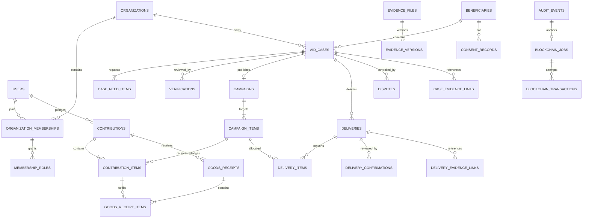

# Database Design

Ngày tạo: 03/11/2026. Owner: B. Status: **relational schema proposal**, chưa có migration/database. Sources: PDF p.12; chi tiết bổ sung để thực thi BR và lựa chọn multi-item của user.

## Conventions

PostgreSQL 17. `uuid` PK cho operational records; `bytea` length=32 cho chain references/commitments; `timestamptz` UTC; quantities `integer` CHECK >=0 và input <=1,000,000 mỗi line để tránh overflow. IDs không encode tên/số điện thoại. String status dùng varchar + CHECK để Flyway dễ evolve; không PostgreSQL enum types.

Mutable tables có `created_at`, `updated_at`, `version bigint NOT NULL DEFAULT 0`. Immutable records có `created_at`, không UPDATE/DELETE từ application role sau insert (status/projection thuộc bảng mutable tương ứng). Every org-owned aggregate có `organization_id NOT NULL`; cross-aggregate references phải verify cùng org/campaign. Foreign-key delete mặc định RESTRICT; không cascade-delete audit/evidence history.

## Conceptual ERD

## Relational schema

Trong bảng dưới, `id uuid PK` và common timestamps được ngầm hiểu trừ bảng có composite key được ghi rõ. `FK` là foreign key; `UQ` unique; mọi required field NOT NULL trừ `?`.

| Table | Columns chính / relationships | Constraints / ownership / indexes |
|---|---|---|
| organizations | name varchar(160), status APPROVED/SUSPENDED, public_ref bytea32 UQ, relayer_address varchar(42)?, approved_by FK users?, approved_at? | Index status; relayer secret không trong row; organization approval không tự đồng nghĩa chain registration |
| users | email varchar(254), password_hash varchar(255), display_name varchar(120), enabled boolean, platform_admin boolean, donor_enabled boolean | UQ lower(email); seed secrets không plaintext; indexes enabled |
| organization_memberships | organization_id FK, user_id FK, active boolean | UQ(org,user); indexes(user,active); role lookup luôn membership active |
| membership_roles | membership_id FK, role varchar(40) | Composite PK(membership_id,role); CHECK OA/FV/CV/DC; không gán PA ở org role |
| beneficiaries | organization_id FK, alias varchar(120), private_details_ciphertext bytea?, key_version?, approximate_area varchar(160) | No globally dedup hash of identity; UQ(id,org) hỗ trợ composite FK; index org |
| consent_records | organization_id FK, beneficiary_id FK, recorded_by FK users, basis CONSENT/REPRESENTATIVE, scope varchar(200), captured_at timestamptz, public_summary_allowed boolean, evidence_version_id? | Immutable; index beneficiary/time; demo luôn fictional consent, không legal compliance assertion |
| aid_cases | organization_id FK, beneficiary_id FK, consent_record_id FK, creator_id FK users, status, public_ref bytea32 UQ, internal_title varchar(160), public_title?, public_summary?, approximate_area?, priority NORMAL/URGENT, submitted_at, completed_at?, supersedes_case_id FK self? | Composite FKs beneficiary/consent org; index(org,status,created_at); version for PATCH; reviewed fields locked |
| case_need_items | organization_id FK, case_id FK, name varchar(120), unit varchar(40), requested_qty integer | requested_qty>0; UQ(case,lower(name),unit); editable only with case version before approval; reviewed snapshot captures IDs/values |
| verifications | organization_id FK, case_id FK, reviewer_id FK users, decision, reason?, reviewed_case_version bigint, snapshot jsonb, reviewed_at | Immutable; reason required for rejection/changes; index(case,reviewed_at); creator!=reviewer service check under case lock |
| campaigns | organization_id FK, case_id FK UQ, status DRAFT/PUBLISHED/FULFILLED/CLOSED, title varchar(160), public_summary varchar(2000), published_at?, closed_at? | One case/one campaign; index(status,published_at); no beneficiary PII |
| campaign_items | organization_id FK, campaign_id FK, case_need_item_id FK, name varchar(120), unit varchar(40), target_qty integer | UQ(campaign,case_need_item); UQ(campaign,lower(name),unit); target>0; copy all approved need lines, exact approved quantities; targets immutable after publish |
| contributions | organization_id FK, campaign_id FK, donor_id FK users, public_ref bytea32 UQ, created_at | Immutable identity header; progress derived from items; index(donor,created_at), campaign |
| contribution_items | organization_id FK, contribution_id FK, campaign_item_id FK, pledged_qty integer, cancelled_qty integer default0 | UQ(contribution,campaign_item); pledged>0; 0<=cancelled<=pledged; same campaign composite FK/service validation; lock on receipt/cancel |
| goods_receipts | organization_id FK, contribution_id FK, recorder_id FK users, received_at timestamptz, note? | Immutable; index(contribution,received_at); active pledge check |
| goods_receipt_items | organization_id FK, receipt_id FK, contribution_item_id FK, quantity integer | quantity>0; UQ(receipt,contribution_item); same contribution/org; sum bound via locks |
| deliveries | organization_id FK, case_id FK, recorder_id FK users, public_ref bytea32 UQ, outcome DELIVERED/FAILED, recorded_at, handed_over_at?, reason? | Immutable claim fields; current review/void status derived from confirmation/dispute decisions, no duplicated mutable status column; failed reason required |
| delivery_items | organization_id FK, delivery_id FK, campaign_item_id FK, quantity integer | quantity>0 for successful delivery; FAILED has no rows; UQ(delivery,item); same case campaign |
| delivery_confirmations | organization_id FK, delivery_id FK, reviewer_id FK users, decision CONFIRMED/REQUIRES_REVIEW, reason?, evidence_snapshot jsonb, reviewed_at | Immutable decisions; partial UQ(delivery_id) WHERE decision='CONFIRMED'; index(delivery,time); voided delivery retains historical decision, replacement uses a new delivery ID; self-confirm guard service |
| disputes | organization_id FK, case_id FK, delivery_id FK?, opened_by FK users, reason varchar(2000), status OPEN/RESOLVED, resolution UPHOLD/VOID_DELIVERY?, resolved_by FK users?, resolution_reason?, resolved_at? | delivery must belong case; VOID_DELIVERY requires delivery_id; index(case,status); resolution fields all-or-none; immutable opening fields |
| evidence_files | organization_id FK, logical_name varchar(160), case_id FK, created_by FK users | Logical artifact identity, no public URL; evidence all belongs one case |
| evidence_versions | organization_id FK, evidence_file_id FK, version_no integer, fixture_key varchar(120), mime_type, byte_size bigint, sha256 bytea32, created_by FK users, supersedes_id FK self? | UQ(file,version_no); immutable; fixture allowlist only; CHECK byte_size>=0 and hash length32; no arbitrary filesystem paths |
| case_evidence_links | organization_id FK, case_id FK, evidence_version_id FK, attached_by FK users | Composite PK(case,version); immutable; same case/org; approved snapshot does not follow newest version automatically |
| delivery_evidence_links | organization_id FK, delivery_id FK, evidence_version_id FK | Composite PK(delivery,version); immutable; version must belong owning case |
| audit_events | organization_id FK, case_id FK?, actor_id FK users?, event_type varchar(64), event_id bytea32 UQ, schema_version integer, sequence_no bigint, entity_id uuid, request_id uuid, payload_private jsonb, public_projection jsonb, occurred_at | Immutable; UQ(case,sequence_no) where case present; index(org,time),(case,sequence); no credentials/PII in public projection |
| idempotency_records | actor_id FK users, operation varchar(120), key varchar(128), request_digest bytea32, response_status integer, response_private jsonb, completed_at | UQ(actor,operation,key); record written atomically with mutation; body excludes passwords/keys; retain demo lifetime, no expiry replay hole |
| blockchain_jobs | audit_event_id FK UQ, organization_id FK, case_id FK?, logical_event_id bytea32 UQ, chain_sequence bigint?, deployment_id varchar(80), state, dependency_event_id bytea32?, next_attempt_at, lease_until?, attempt_count integer, commitment bytea32, manifest_private jsonb, salt_ciphertext bytea, last_error_code? | Mutable sync state only; UQ(case_id,chain_sequence) for case milestones; org registration has no case sequence; index(state,next_attempt_at); immutable target/context/commitment; dependency prevents out-of-order anchoring |
| blockchain_transactions | job_id FK, chain_id bigint, contract_address varchar(42), signer_address varchar(42), nonce bigint, tx_hash varchar(66) UQ, signed_tx_ciphertext bytea, attempt_state, receipt_private jsonb?, block_number bigint?, block_hash?, prepared_at,broadcast_at?, checked_at? | UQ(chain,signer,nonce) for no automatic fee replacement MVP; length/nonce checks; index(job,prepared_at); attempts never overwrite earlier hashes |
| blockchain_sync_cursors | chain_id bigint, contract_address varchar(42), deployment_block bigint, next_block bigint, last_verified_block_hash?, last_scan_at? | Composite PK(chain,contract); next_block>=deployment_block; no volatile-only cursor |

Để deduplicate observed logs, thêm `blockchain_log_observations` (chain_id, tx_hash, log_index composite PK, contract_address, event_id, block_number, block_hash, observed_at). Đây là projection/reconciliation ledger, không business event mới. Contract deployments được lưu trong reviewed deployment manifest và `deployment_id` cấu hình; chưa cần deployment management service.

## Implementation notes cho constraints

SQL CHECK không kiểm tra được sums qua rows hoặc user identity ở bảng khác. Các bounds BR-02/04/06/07/ownership nằm ở transactional services; FK/unique/check là defense-in-depth. Không ghi aggregate counters riêng trong MVP; tính sums dưới item locks với indexes. Nếu tối ưu counters sau này phải có reconciliation tests.

Để composite FK nhất quán, parent org-owned table thêm UQ(id,organization_id); child FK(parent_id,organization_id). Với item-campaign/contribution correlation, repository loads validated joins dưới locks; migrations có composite unique keys phù hợp thay vì chỉ tin body IDs. Chỉ dùng jsonb cho immutable review/audit snapshots, không giấu relational goods lines trong JSON.

Một delivery có nhiều review decisions nhưng chỉ một CONFIRMED decision được insert thành công; duplicate request dùng idempotency, different-key double confirmation 409. Khi VOID_DELIVERY, giữ confirmation row nhưng aggregate join loại delivery có resolved VOID_DELIVERY dispute. Re-review sau REQUIRES_REVIEW tạo decision mới; old rows bất biến.

Cancelled remainder có audit AID_COMMITMENT_REDUCED và chain job; cancelled_qty là projection có version, original pledge immutable. Receipt corrections không hỗ trợ PATCH/reverse trong P0; flag dispute, giữ record và không complete sai. Mở rộng reversal cần decision riêng.

## Sensitive-data boundaries / retention

- Public projection chỉ title/approximate area đã sanitize, item targets/totals, milestone type/time và chain proof; không internal user email, beneficiary alias hay private file key.
- Optional private_details chỉ simulated và encrypted khi persisted; key ở secret store, không database. Không collect health/ID/address thật trong demo.
- Evidence fixture bytes nằm private backend path; DB lưu allowlisted fixture_key, SHA-256, MIME/size. GET file qua ownership guard, no direct URL.
- File/evidence versions và audit không soft-delete để che lịch sử. Suspend users/org bằng flags; không hard-delete khi còn business references.
- Demo dataset backup/reset sau submission theo retention policy trong Security; không cascade xóa chain history. Real data retention và deletion workflow cần operational/legal review trước pilot.

## Transaction scopes và Flyway plan

| Migration proposal | Objects | Verification |
|---|---|---|
| V1 identity | organizations/users/memberships/roles | FK/role constraints, lower-email unique, bootstrap sau schema |
| V2 cases/evidence | beneficiary/consent/cases/reviews/evidence/version links | Ownership FKs; immutable snapshot; case version checks |
| V3 campaigns/goods | campaign/items/contributions/items/receipts/items | Positive quantities, same campaign, concurrency services |
| V4 delivery/control | deliveries/items/confirmations/disputes | Duplicate confirmation, immutable decision history |
| V5 audit/chain | audit/idempotency/jobs/transactions/cursors/log observations | UQ logical IDs/nonce; pending indexes; durable retry |

Không tạo migration files trong planning. Application setup dùng Flyway validate, không Hibernate ddl-auto update. Schema test từ empty PostgreSQL và upgrade từ version trước; bootstrap simulated accounts/evidence ở demo-only profile/tooling, không plaintext passwords trong migration. Deployment không rollback bằng xóa migration đã apply; dùng forward fix và backup restore khi cần.
