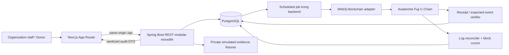

# System Design

Ngày tạo: 03/11/2026. Owner: B. Status: **proposed architecture**, chưa scaffold. Sources: PDF pp.11-13, user choices và [Decision Log](../planning/DECISION_LOG.md).

## Architecture và request flow

1. Browser lấy CSRF token, login bằng account riêng; session cookie được set và session ID đổi sau login.
2. Frontend gọi `/api` cùng origin qua Next rewrite/proxy. Browser không giữ token trong localStorage và không trực tiếp gửi blockchain transactions.
3. Spring Security xác thực; service lấy actor/org từ authenticated principal và active membership, không tin organizationId/creatorId từ body.
4. Service load private resource theo organization, check role, identity separation, state và quantity limits.
5. SQL transaction ngắn ghi business record, audit và blockchain job nếu cần; response thể hiện business result + PENDING_ON_CHAIN.
6. Worker claim job bằng lease, ký/lưu attempt, broadcast ngoài SQL transaction. Receipt job và reconciler cập nhật projection.
7. UI refresh audit khi pending, hiển thị ba lớp status riêng và explorer link chỉ đúng network/contract.

PostgreSQL là operational source of truth. Chain là external anchor của selected milestones, không operational DB. API không rollback physical/business state vì RPC lỗi; audit thể hiện thiếu anchor để reviewer nhận biết.

## Technology baseline đề xuất

| Layer | Baseline | Lý do / check tại setup |
|---|---|---|
| Java | JDK 21 LTS, Maven Wrapper | Ít thay đổi, framework-compatible |
| Backend | Spring Boot 4.1.x, Spring Security/JPA/Validation/Actuator, springdoc 3.x | Patch compatible được khóa tại B02; không prerelease |
| Database | PostgreSQL 17, Flyway do Boot dependency management | Docker Compose chỉ sau coding approval; migrations forward-only |
| Frontend | Next.js 16.x, React 19.x, TypeScript, Tailwind 4.x | npm lockfile; no Redux/global state library mặc định |
| Contract | Hardhat 3.x, TypeScript tests, Solidity 0.8.28, OpenZeppelin 5.x | Pin exact compiler + optimizer; target `evmVersion: paris` để tránh opcode mới không cần thiết |
| Java chain | Web3j 4.14.x | Java compatibility, ABI parity test và explicit signing chain ID |
| Node | Supported Node 22 LTS release >=22.13.0 | Verify Hardhat/Next support và security patch trước install |
| API/test | REST/OpenAPI, JUnit, PostgreSQL integration, Hardhat, Playwright | Chỉ thêm library khi giảm effort thực tế |

Không mặc định dùng MapStruct, Lombok, generic base services, event bus hoặc CQRS framework. Plain Java records cho DTO khi phù hợp; handwritten mapper nhỏ. Nếu version family không còn compatible tại setup, ghi verified replacement trong Decision Log trước thay major.

Official references: [Spring Boot requirements](https://docs.spring.io/spring-boot/system-requirements.html), [springdoc](https://springdoc.org/), [Hardhat Node support](https://hardhat.org/docs/reference/nodejs-support). Versions là baseline đề xuất, không được coi dependencies đã được resolve hoặc test.

Frontend installation requirements đối chiếu tại [Next.js installation](https://nextjs.org/docs/app/getting-started/installation). Hardhat3 yêu cầu Node >=22.13.0; dùng supported patched Node22 LTS đáp ứng cả Next/Hardhat, không nhầm với minimum Node20.9 riêng của Next.

## Module responsibilities và concrete components

| Module | Components cần thiết | Owns / dependencies | Verification |
|---|---|---|---|
| auth | AuthController, SecurityConfig, account lookup/password service, UserRepository, LoginRequest/MeResponse | users + global roles; queries organization memberships | AuthApiIT: login/logout/CSRF/session fixation, disabled account |
| organization | OrganizationController/Service/Repository, MembershipRepository, Organization/Membership entities, org DTOs, membership guard | org state/roles; không direct chain signing | MembershipIsolationIT và inactive-member tests |
| casefile | CaseController/Service/Repository, AidCase/Beneficiary/ConsentRecord, create/patch/detail DTOs, evidence access/version service | cases/evidence/consent; organization guard + audit | CaseServiceTest, CaseApiIT, EvidenceAccessIT |
| verification | VerificationController/Service/Repository, Verification, DecisionRequest/Response | immutable review attempts; casefile + audit | SelfApprovalTest, VerificationApiIT |
| campaign | CampaignController/Service/Repository, Campaign/Item, draft/publish DTOs | target lines + published summary; verification/case guard | PublishPreconditionTest, CampaignApiIT |
| contribution | CommitmentController/Service/Repository, Contribution/Item, receipt service/repository, line DTOs | pledges + receipts; locks campaign/items | CommitmentConcurrencyIT, ReceiptApiIT |
| delivery | DeliveryController/Service/Repository, Delivery/Item/Confirmation, DisputeService/Repository | delivery, confirmation, minimal disputes; contribution balances + case state | DeliveryConcurrencyIT, SelfConfirmationTest, DisputeIT |
| audit | AuditController/Service/Repository, AuditEvent, AuditTimeline DTO/projections, idempotency service | immutable audit and sanitized projections; no private entities serialized | AuditPrivacyIT, IdempotencyIT |
| blockchain | BlockchainAdapter interface + Web3j implementation, Job/Transaction/Cursor repositories, submission/receipt/reconcile jobs | outbox/jobs/attempts; reads audit payload snapshots | AdapterContractIT, CrashRecoveryIT, LogReplayIT |
| shared | ProblemDetails handler, clock/ID/config beans, small reusable permission/idempotency types | Không business entity dumping ground | ErrorContractTest |

Không tạo class cho mỗi tên trong bảng nếu có thể là method/value object trong feature tương ứng. Tránh module service cycles: delivery gọi query/service về goods balances; campaign không gọi ngược delivery. Audit nhận immutable business event từ service; blockchain đọc event snapshot, không gọi business controller.

## Transaction và concurrency boundaries

- Case mutation: lock/version case row -> membership/state check -> save -> audit. Verification atomic cùng reviewed snapshot/outbox.
- Multi-line pledge: lock case -> campaign -> requested campaign_items theo UUID sort; check active reservations; save all lines hoặc rollback all.
- Receipt/cancel: cùng lock order, lock contribution lines; cancellation chỉ giảm outstanding pledge.
- Delivery/confirmation/resolve/close: cùng lock case -> campaign -> item rows -> contribution hoặc delivery rows; quantity/dispute checks phải trong transaction.
- Worker lease/nonce journal có SQL transaction riêng; không giữ business locks khi gọi RPC.
- DB unique constraints là backstop; optimistic version mismatch/quantity conflict trả 409, không trả 500 mặc định.
- Một backend replica; vẫn dùng durable leases để crash/restart không mất job. Không tuyên bố exactly-once transport; goal là at-least-once processing với exactly-once logical effect.

## Frontend scope và screen contracts

| Screen / route dự kiến | Roles / purpose | Data & APIs | Components/actions | Loading/empty/error/success |
|---|---|---|---|---|
| `/login` | All seeded accounts | csrf/login/me | Email/password form, login | Disable repeat submit; invalid credentials generic; success route theo role |
| `/org/cases` | Staff | GET cases, filters | Case table, status badges, create link | Skeleton; empty CTA cho FV; retry; no private data trong error |
| `/org/cases/new` | FV | POST case, fixture manifest metadata | Consent, minimal household form, evidence selector | Inline field errors; idempotent submit; success case detail |
| `/org/cases/[id]` | Authorized org staff | case detail, evidence access, verify/reject/request-changes, campaign/receipt/delivery/confirm/dispute | Tabs/sections: need, review, goods, delivery, audit; role/state actions | Separate loading per section; permission/error; disable stale actions và refresh on 409 |
| `/campaigns` | Public/Donor | sanitized GET campaigns | Cards/table với per-item needs | Empty published list; retry; no internal notes |
| `/campaigns/[id]` | Public/Donor | campaign detail, POST commitments, public audit | Target/pledged/received/delivered/confirmed columns từng item; pledge form | Login CTA; 409 remaining-capacity refresh; success commitment ID |
| `/me/commitments` | Donor | own commitments + campaign totals | Contribution history, outstanding/cancel action | Empty CTA; auth redirect; partial receipt clear |

Không cần dashboard/admin portal độc lập. Org Admin campaign và receipt actions nằm ở case detail; minimal Platform Admin dispute action dùng internal case action/API được bảo vệ. Không có member-management UI ở P0.

Mỗi screen có keyboard flow, labels gắn inputs, visible focus, error summary liên kết field, status text ngoài màu sắc, table headings và `aria-live` cho async updates. Reusable components: Button, Input, FieldError, StatusBadge, GoodsProgressTable, EvidenceReference, AuditTimeline, EmptyState, ErrorPanel, ConfirmDialog. Native fetch + local React state trước; không animations phức tạp.

Status copy phải nói đúng: `Pending verification`, `Case verified`, `Goods pledged`, `Goods received`, `Delivery recorded`, `Delivery confirmed by a separate reviewer`, `Pending on-chain`, `Confirmed on Fuji`, `On-chain submission failed`. Không dùng `Blockchain-proven delivery`.

## Deployment/operations boundary

Local: FE :3000 -> API proxy BE :8080, Compose PostgreSQL, Hardhat local node cho tests. Shared integration: cùng public demo project khi sẵn sàng, không tạo hai always-on stacks gây vượt budget. Staging smoke có thể dùng local + immutable build trước public rollout.

Public: Railway FE/BE/PostgreSQL, BE một replica, TLS FE, private backend/DB networking, environment secrets. Demo fixtures nằm trong protected backend storage, không public assets folder. Actuator health public chỉ summary; detailed health/swagger admin/dev-only. Rollback, cost và backup xem Master Plan/Security. Không có deployment thật ở giai đoạn này.
