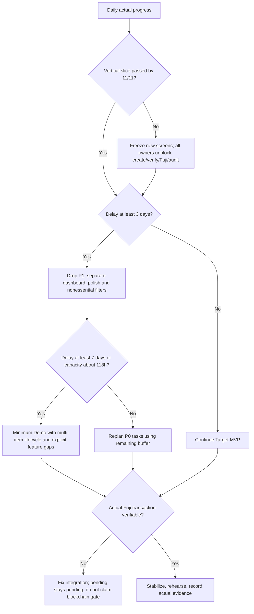

# Risk Register

Ngày tạo: 03/11/2026. Owner: F; each risk owner below. Status: prospective risks, không phải incidents đã xảy ra. Probability/impact H/M/L là qualitative planning estimates.

| ID | Risk / probability / impact | Early warning | Prevention | Mitigation / contingency | Owner |
|---|---|---|---|---|---|
| R01 | No NGO contact / H/H | 05/11 chưa có lịch interview | Tìm2-3 người có kinh nghiệm, workflow prototype nhỏ | Ghi unvalidated assumptions; technical demo, không claim partner | F |
| R02 | Problem/adoption unvalidated / H/H | Người được hỏi chỉ muốn tiếp tục spreadsheet | Hỏi actual workflow/pain, test prototype | Điều chỉnh UX trong scope; pilot research sau hackathon | F |
| R03 | Scope creep / H/H | Thêm upload/report/AI khi slice chưa chạy | P0 freeze, task owner, change estimates | Remove P1/polish; không tự giảm multi-item user choice | B |
| R04 | Solidity learning / H/H | 07/11 chưa compile/test access control | JIT exercises + Hardhat single toolchain | B review roles; F giúp TypeScript tests; simplify contract storage | C |
| R05 | Contract vulnerabilities / M/H | Tests chỉ deployer happy path | OpenZeppelin, no money/proxy/external calls | Stop deploy, fix/retest; new deployment preserves old evidence | C |
| R06 | ABI/event integration mismatch / M/H | Java decode khác TS fields | Schema freeze, shared test vectors, export ABI | Fix adapter before screens; no manual fake tx status | C |
| R07 | RPC/receipt delays / H/M | Pending>10m, faucet/balance problems | Durable journal, monitor balance, early pilot | Reconcile same hash, show pending, backup actual prior tx/video | C |
| R08 | Auth/tenant bug / M/H | Frontend hides button but API accepts | Service guards, identity tests, scoped queries | Block public release until fixed; reduce interface breadth | B |
| R09 | Privacy leak / M/H | PII/file URLs in DTO/log/calldata | Simulated data, allowlists, private fixtures | Suspend public writes/read, remove exposure, rotate secrets; chain disclosure immutable | B |
| R10 | FE/BE contract drift / H/M | Frequent ad hoc response field changes | DTO/error examples and mocks agreed05/11 | Update contract+mocks+tests together; integration checkpoint | B/F |
| R11 | Deployment/cost/eligibility / M/H | Spring OOM, card requirement, projected cost>$20 | Early budget check, one replica/project, usage controls | Local/video fallback, no overspend without user instruction | F |
| R12 | One member behind / H/H | Critical task blocked>1 daily checkpoint | Single owner + support/reviewer, small tasks | Reassign support work; freeze unrelated tasks, pair critical path | All, B coordinates |
| R13 | Incomplete demo / M/H | 22/11 cannot run all roles end-to-end | Script early, vertical slice11/11 | Minimum Demo, record gaps honestly, stable build/video | F |
| R14 | Insufficient testing / H/H | Feature Done only means code compiles | Positive/negative tests within every task | Cut polish/features outside P0, preserve BR and regression gates | C |
| R15 | Overengineering / M/H | Generic framework/infra before workflow | Modular monolith, no queue/warehouse | Delete proposal from backlog before implementation; plain services | B |
| R16 | Quantity/concurrency bugs / H/H | Multi-item progress totals inconsistent | Per-line constraints, shared lock order, PostgreSQL tests | Freeze goods writes, reconcile records, no manual data fabrication | B |
| R17 | Private-key compromise / L/H | Key in logs/git or unknown chain events | Dedicated test keys, separate admin, secrets scan | Revoke/rotate/suspend/reconcile; preserve incident history | C |
| R18 | Time/estimates too optimistic / H/H | Burned buffer before18/11 | 56h task +8h reserve/person, JIT learning included | Reforecast actual remaining hours; Minimum Demo instead of false Target claim | F |
| R19 | No-show donor/no confirmer / M/M | Pledge stale, delivery waiting review | Distinct statuses, actionable pending queue | Manual contact; cancel outstanding via donor; no auto-complete | B/F |
| R20 | Competition requirements unknown / M/H | No official submission URL/time by06/11 | Owner verifies organizer instructions | Mark planning deadline tentative; prepare core assets early | F |
| R21 | Insider collusion / M/H | Same small group controls all reviews | Separation, append-only audit, disputes | Explicit trust limitation; real pilot independent sampling/governance | F |

## Scope-reduction decision tree

Nếu blockchain unstable18/11: freeze enhancements, use one organization/signer, one sequential worker, minimal milestone set for Minimum Demo; Target MVP thiếu anchors phải được ghi rõ. Không bỏ durable IDs, authorization, receipt checks hoặc separation guards. Trước25/11 có thể trình bày actual historical verification tx và live pending action; phân biệt trạng thái rõ.

## Invariants không được cắt

Distinct creator/verifier và delivery recorder/confirmer; case verified trước public support; per-item quantity conservation; no PII/file gốc on-chain; evidence versions/audit; failed tx không confirmed; unique commands/events; authorized contract caller; complete operational lifecycle; simulated data label; actual Fuji evidence cho blockchain claim.

## Escalation và monitoring

Daily standup ghi blocked task/reason/next action. Critical dependency blocked>1 ngày hoặc buffer consumption>50% trước18/11 -> checkpoint cả nhóm, assign helper và scope cut. Authentication/privacy/false-confirmation bug -> release blocker ngay, không chờ threshold. Forecast budget>$20 -> dừng purchase/scale và review; không có authorization tự tăng budget. Ngoài nhóm không tự gửi messages khi chưa được user yêu cầu.

## F01 - bằng chứng validation ngày 10/11/2026

R01 vẫn OPEN: chưa có danh sách ứng viên thật/lịch hẹn/ghi chú consent được cung cấp trong repo; không có liên hệ bên ngoài trong phiên F01. Owner thực hiện research: Khoa/nhóm; next action: xác định 2-3 người có kinh nghiệm và xin consent trước ghi notes. R02 vẫn UNVALIDATED: scenario/assumptions không phải phản hồi người dùng; chưa claim adoption, partner hoặc impact. [F01 Product/Validation](../product/validation/F01_DEMO_AND_ASSUMPTIONS.md) ghi 10 giả định, tác động và cách kiểm chứng. Không thay probability/impact, owner lịch sử hoặc đóng risk vì hoàn thành tài liệu.
